<div align="center">

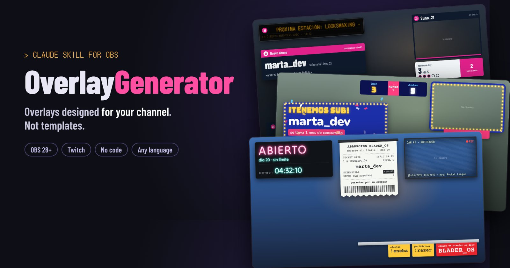

# OverlayGenerator

**A Claude skill that designs a complete OBS overlay pack around *your* channel, not a template with your name on it.**

**English** · [Español](docs/i18n/README.es.md) · [Português (BR)](docs/i18n/README.pt-BR.md) · [Français](docs/i18n/README.fr.md) · [Deutsch](docs/i18n/README.de.md) · [Italiano](docs/i18n/README.it.md) · [日本語](docs/i18n/README.ja.md) · [한국어](docs/i18n/README.ko.md) · [简体中文](docs/i18n/README.zh-CN.md)


[What you get](#-what-you-get) · [Examples](#-not-templates) · [Alerts](#-alerts-in-action) · [Panel](#️-the-control-panel) · [Install](#-install-the-skill) · [Set up OBS](#️-set-up-obs-step-by-step) · [FAQ](#-faq--troubleshooting) · [Translate](#-translations)

</div>

> [!IMPORTANT]
> **v1 beta.** The skill, the engine and a complete example pack are here. Every part has been tested against a simulated OBS, and the core (panel, one-click install, hotkeys, chat commands, memory) in a real OBS 32 on Windows. Found a bug? [Open an issue](https://github.com/Ro0oman/OverlayGenerator-Claude-Skill/issues).

---

## ✨ What it does

You tell Claude about your stream, or just paste your Twitch channel. Claude looks at what you play, how you talk to your chat and what makes your channel *yours*, and then designs a full overlay pack around it:

```text
You:    Make me an overlay pack. My channel is twitch.tv/your_channel
Claude: I looked at your last streams: mostly Elden Ring, no-hit runs,
        Spanish-speaking chat, you count deaths by hand in the title...
        Here are two directions. Which one feels like you?
```

You pick a direction, Claude builds the pack, and you get a zip with everything ready for OBS. No coding, no templates to fill in.

## 🎁 What you get

| What | Details |
|---|---|
| 🎬 **Scenes** | Starting soon, Be right back, Ending, plus your main scenes (game, just chatting, coding, news desk…) |
| 🔔 **Alerts** | Sub, resub, gifted sub, sub bomb, raid and bits, each one written in your channel's language and humour |
| 💬 **Chat & goals** | On-screen chat, sub goal and camera frame that match the rest of the pack |
| 🧩 **Pieces made for your format** | Death counter, boss tracker, topic agenda, news ticker, day counter… whatever your stream actually needs |
| 🎛️ **Control panel inside OBS** | Buttons, **hotkeys** and **chat commands for your mods** to drive every piece live |
| ⚙️ **"Install in OBS" button** | Creates the scenes and sources for you, already positioned |
| 👀 **Preview** | Double-click `preview.html` to see the whole pack before touching OBS |
| 📖 **Guide** | A friendly step-by-step guide in your language |

## 🎨 Not templates

Every pack starts from **the idea behind your channel**, not from a style menu. These are concepts made while developing the method. One event, a new subscriber, looks completely different on five channels:

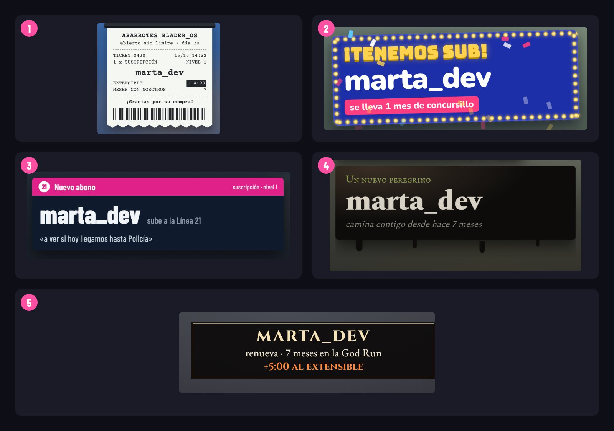

| # | Channel idea | The sub alert becomes… |
|---|---|---|
| 1 | A never-ending subathon full of sponsor codes → **a 24h corner shop** | A printed till receipt: "1 × subscription · subathon +10:00 · Thanks for shopping!" |
| 2 | A host who runs his own quiz shows → **a retro TV game show** | "We have a sub!" with marquee lights, confetti and a prize |
| 3 | Talk streams that go through a list of topics → **a metro line** | "New pass holder · boards Line 21"; each topic is a station |
| 4 | Plays a soulslike while walking on a treadmill → **a pilgrimage** | "A new pilgrim walks with you" in a tar stain |
| 5 | Hitless runs, where only one number matters → **zero hits** | A thin victory banner that also says how much time it adds to the subathon |

<details>
<summary><b>🖼️ See the full scenes</b></summary>
<br>

| | |
|---|---|
| 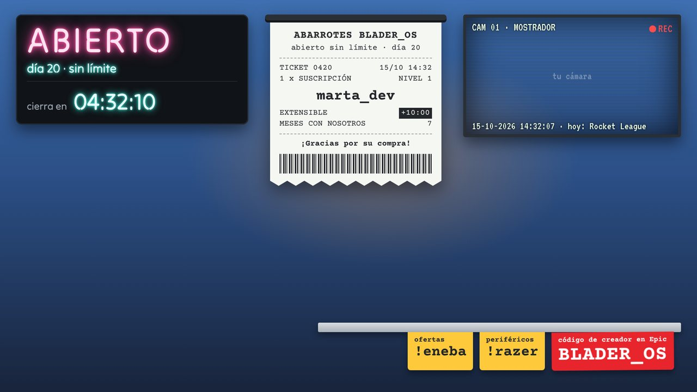 **Corner shop**: neon "OPEN" sign with the subathon timer, receipt alerts, sponsor price tags | 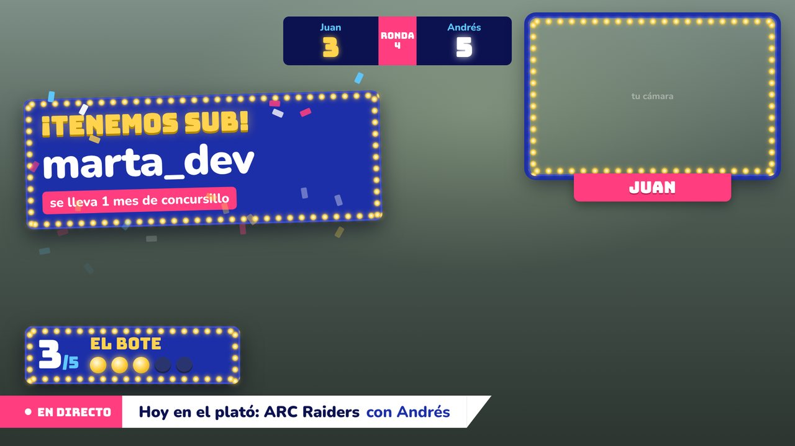 **Game show**: duo scoreboard, "the jackpot" sub goal, studio-style lower third |
| 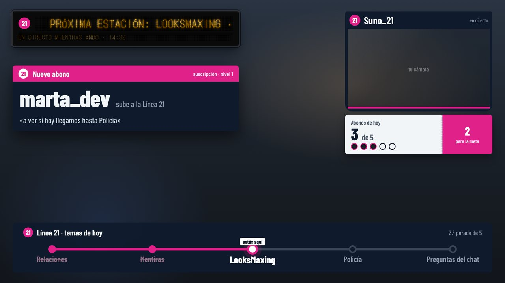 **Metro line**: the day's topics as stations, LED "next stop" board, ticket-punch goal | 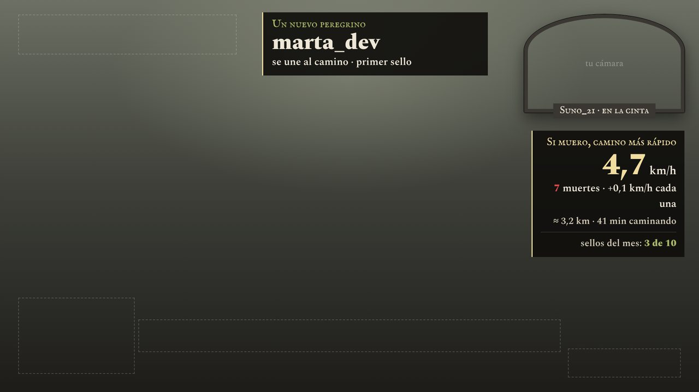 **Pilgrimage**: deaths speed up the treadmill, steps of the day, pilgrim seals as sub goal |
| 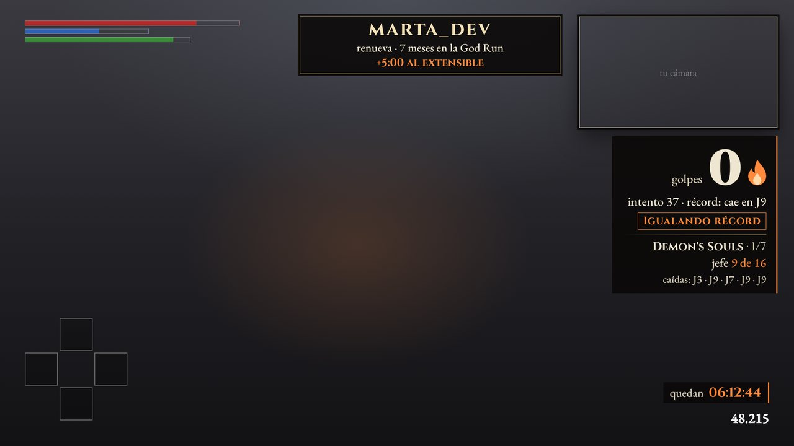 **No-hit run**: the 0 is the hero, attempt, record and boss progress; stays clear of the game HUD | 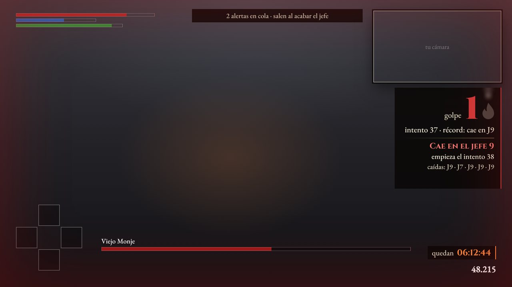 **…when you take a hit**: the 0 turns into a red 1, the bonfire goes out and alerts wait until the boss is over |

<sub>Unofficial concept art based on public channel information, made only to develop and test the method. Not affiliated with or endorsed by these creators. "marta_dev" is a made-up viewer.</sub>

</details>

### 🔔 Alerts in action

Every pack animates its alerts its own way. Same viewer, same sub, six moods:

<table><tr><td width="50%" align="center">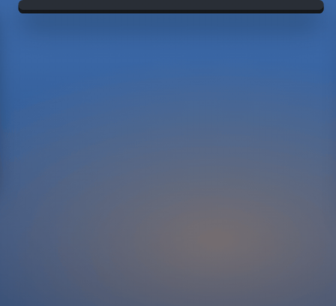<br><b>Corner shop</b>: printed like a till receipt</td><td width="50%" align="center"><br><b>Game show</b>: marquee lights, confetti and a prize</td></tr><tr><td width="50%" align="center">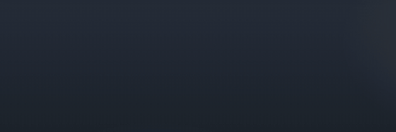<br><b>Metro line</b>: slides in like a platform sign</td><td width="50%" align="center">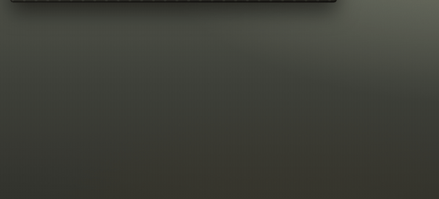<br><b>Pilgrimage</b>: tar seeps through the stone</td></tr><tr><td width="50%" align="center">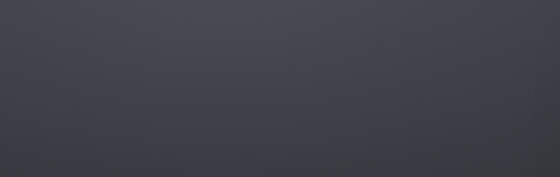<br><b>No-hit run</b>: a thin banner that stays out of the fight</td><td width="50%" align="center">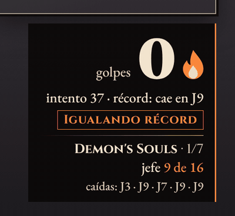<br><b>…and the hit</b>: the zero turns red and the bonfire dies</td></tr></table>

<sub>Same unofficial concepts as above. In your pack, every alert is designed for your channel.</sub>

### Design rules every pack follows

- 🎯 **Made for your channel.** Each piece is checked with a simple test: "would this make sense on another channel?" If yes, it gets redesigned.
- 🕹️ **Respects the game.** Pieces stay away from the game's HUD (health bar, minimap, scoreboard) and take up only a small part of the screen.
- 🔠 **Readable on a phone.** Large text and strong contrast, checked automatically on every scene.
- 🧘 **Calm by default.** Nothing loops forever; only events move.
- ©️ **No official assets.** It can *evoke* your game, but never uses logos, characters, artwork or official fonts.
- 🌍 **In your language.** The pack language is detected from your channel; the alerts sound like your chat.

## 🎛️ The control panel

Every pack comes with its own panel, docked inside OBS. Claude only puts in it what your stream uses: the buttons, hotkeys and chat commands of *your* pieces.

<p align="center">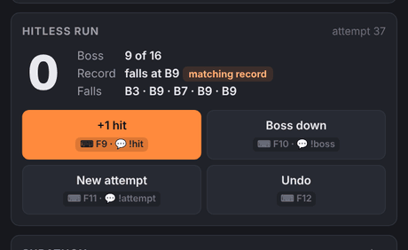</p>
<p align="center"><sub>Press <b>F9</b> in game, or a mod types <code>!turb</code>: turbulence goes up. <b>Final approach</b> holds alerts during a boss fight; <b>Undo</b> fixes a slip.</sub></p>

<table><tr><td width="33%" valign="top">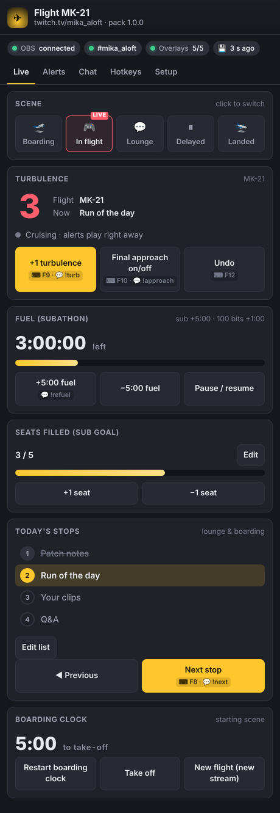<br><b>Live</b>: Switch scenes and drive every piece. Each button shows its hotkey and chat command.</td><td width="33%" valign="top">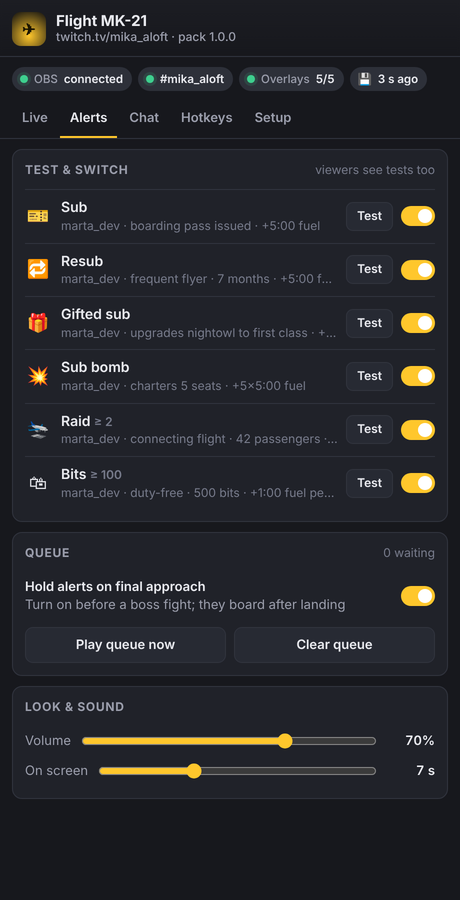<br><b>Alerts</b>: Test each alert, switch them on or off, and hold them during boss fights.</td><td width="33%" valign="top">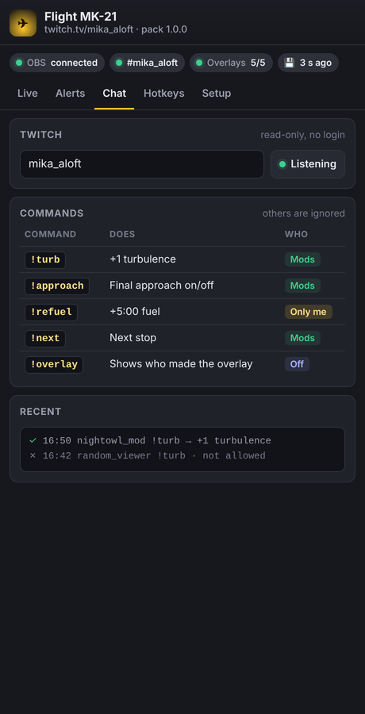<br><b>Chat</b>: Commands and who can use them. Commands from non-mods are ignored and logged.</td></tr></table>

<details>
<summary><b>More: hotkeys and setup</b></summary>
<br>

<table><tr><td width="50%" valign="top">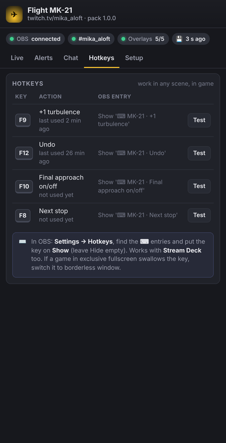<br><b>Hotkeys</b>: Each key, the OBS entry it uses and when it was last pressed.</td><td width="50%" valign="top">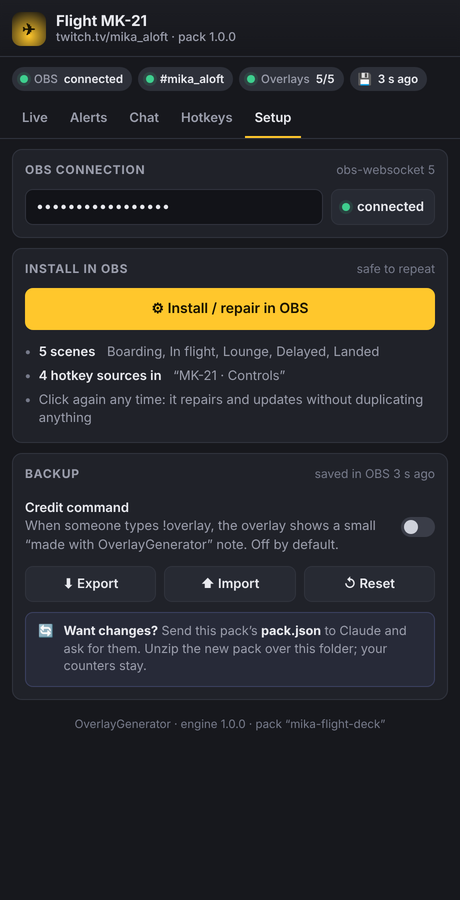<br><b>Setup</b>: Connection, one-click install or repair, backups and how to update the pack.</td></tr></table>

</details>

<sub>The v1 panel running in demo mode with a made-up channel. The cards, buttons and commands change with every pack.</sub>

---

## 🧠 How it works

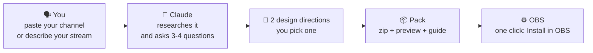

Inside OBS, the pack uses **OBS's own WebSocket**. There's nothing extra to install: no Python, no server, no account.

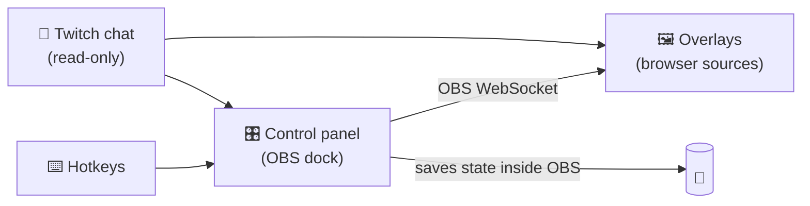

---

## 📋 Requirements

- **OBS Studio 28 or newer** (Windows tested; macOS and Linux planned)
- **A Claude account** with *Code execution and file creation* turned on (available on Free, Pro, Max, Team and Enterprise)
- **A Twitch channel** for alerts and chat (YouTube and Kick are planned)

## 📥 Install the skill

> [!NOTE]
> Download `overlay-generator.zip` from the [latest release](https://github.com/Ro0oman/OverlayGenerator-Claude-Skill/releases/latest).

### In the Claude app (web, desktop)

1. Download `overlay-generator.zip` from the latest release. **Don't unzip it.**
2. In Claude, open **Settings → Capabilities** and turn on **Code execution and file creation**.
3. Go to **Customize → Skills**, click **+**, then **+ Create skill → Upload a skill**.
4. Pick the zip and make sure the skill is **switched on**.

On Team and Enterprise plans, an owner may need to allow skills first. See [Use skills in Claude](https://support.claude.com/en/articles/12512180-use-skills-in-claude).

### In Claude Code

Skills enabled in your Claude account sync to Claude Code automatically (run `/skills` to check). To install it locally instead, unzip it into `~/.claude/skills/`:

```bash
unzip overlay-generator.zip -d ~/.claude/skills/
```

Or install it as a plugin, straight from this repository:

```text
/plugin install overlay-generator --marketplace Ro0oman/OverlayGenerator-Claude-Skill
```

## 🚀 Create your pack

Start a new chat and say something like:

> *Make me an OBS overlay pack. My channel is twitch.tv/your_channel*

or, without a channel:

> *I stream Minecraft hardcore in French, chill vibe, I want a day counter and a goal for 10 subs.*

Claude will:

1. **Ask for 1–2 screenshots of your stream.** This is optional but makes a big difference: it shows where your camera and the game HUD are.
2. Summarise what it found and ask a few short questions (camera or VTuber, sub goal, sponsors, topics to avoid).
3. Show **two design directions** with a preview. You pick one or ask for changes.
4. Give you the **pack zip**.

---

## 🛠️ Set up OBS, step by step

It takes about 5 minutes and you only do it once.

### 1. Unzip the pack in a permanent folder

Unzip it to something like `C:\Overlays\my-pack`.

> [!WARNING]
> **Not** in Downloads, **not** inside the zip and **not** in a OneDrive/Dropbox synced folder. OBS keeps pointing at this folder, so if it moves, the overlays break.

### 2. Turn on the OBS WebSocket

1. In OBS, open **Tools → WebSocket Server Settings**.
2. Tick **Enable WebSocket server**.
3. Keep **Enable Authentication** ticked and click **Show Connect Info** to copy the **password**.
4. Click **OK**.

### 3. Add the control panel as a dock

1. Open **Docks → Custom Browser Docks…**
2. Name it, for example `Overlay panel`.
3. In URL, paste the address of `panel.html` from your pack folder, e.g. `file:///C:/Overlays/my-pack/panel.html`.
4. Click **Apply**. The panel appears as a dock and you can drag it wherever you like.

### 4. Connect and install

Paste the WebSocket password into the panel, click **Connect**, then click **⚙ Install in OBS**.

The panel creates every scene and source for you, already positioned. Clicking it again is safe: it repairs or updates without duplicating anything.

<p align="center">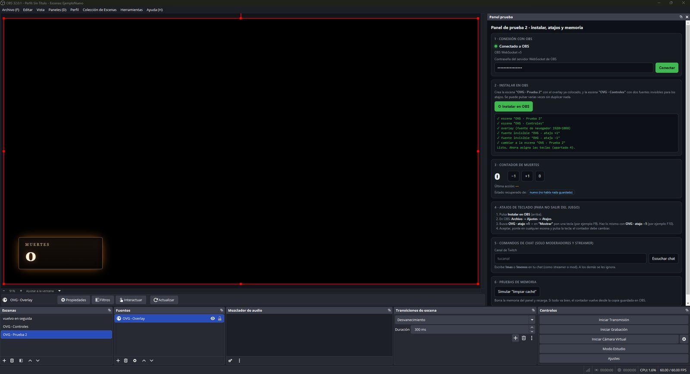</p>
<p align="center"><sub>Prototype panel docked in OBS 32 right after "Install in OBS". The final panel's look may change.</sub></p>

### 5. Optional: hotkeys, so you never leave the game

Some pieces (a death counter, "next boss", "next topic"…) come with hotkeys.

1. Open **Settings → Hotkeys**.
2. Search for the pack's **OVG ·** entries.
3. Set a key on **Show 'OVG · …'** (for example F9 for +1). Leave **Hide** empty.
4. Click **OK**. The key now works from any scene, even while you're in the game.

<table><tr>
<td width="55%">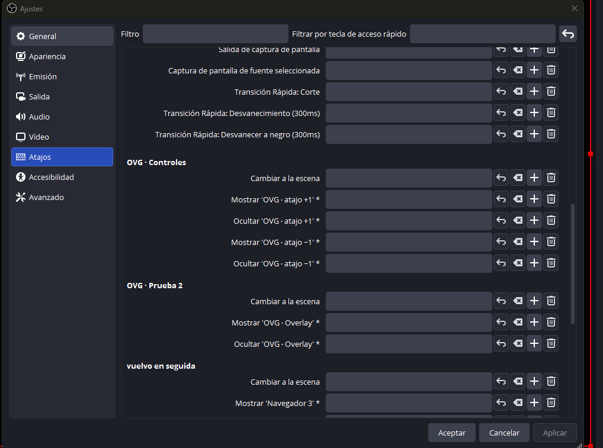</td>
<td>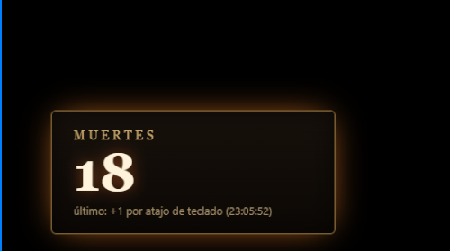<br><sub>Set a key on <b>Show</b>, press it in game, and the overlay updates.</sub></td>
</tr></table>

> [!TIP]
> Hotkeys also work with a **Stream Deck**, using its OBS hotkey action.

### 6. Optional: chat commands for your mods

Type your channel name in the panel and click **Listen to chat**. From then on your mods (and you) can use the commands your pack comes with, like `!death` or `!next`. Commands from everyone else are ignored.

### 7. Go live

> [!CAUTION]
> **Keep the panel open while you stream.** It's the brain of the pack. You can minimise the dock, but don't close it. If it closes, the overlays keep the last state and show a small **"Panel closed"** notice, so even your viewers can tell you.

---

## 🔄 Update or change your pack

Send Claude your pack zip (or just its `pack.json`) and say what you want: *"update it"*, *"add a boss tracker"*, *"make the alerts louder"*.

1. Claude rebuilds the pack with **the same file names**.
2. Unzip it **over** your old folder.
3. If there are new pieces, click **Install in OBS** again.

Your counters and settings are kept.

## ❓ FAQ & troubleshooting

<details>
<summary><b>The overlay is blank or doesn't react</b></summary>

- Check that the panel says **Connected to OBS**.
- If you added a source by hand: in the browser source settings, **untick "Local file"** and paste the full `file:///…` address. With "Local file" ticked, the settings in the address are lost.
- Right-click the source → **Refresh**.
</details>

<details>
<summary><b>"Panel closed" appears on stream</b></summary>

The control panel dock was closed. Open it again from **Docks** and the notice disappears within a few seconds.
</details>

<details>
<summary><b>A hotkey doesn't work inside one game</b></summary>

Some games in **exclusive fullscreen**, or with strict anti-cheat, swallow key presses. Switch the game to **Borderless window**. If that doesn't help, use the chat command or a Stream Deck.
</details>

<details>
<summary><b>I cleared the OBS browser cache. Did I lose my counters?</b></summary>

No. The panel keeps a copy of its state inside your OBS profile and restores it automatically. This was tested with cache clears and OBS restarts.
</details>

<details>
<summary><b>Is my WebSocket password safe in the overlay addresses?</b></summary>

The overlays need it to talk to OBS, so it's part of their address. It only gives access from your own computer or local network. If you think it leaked, generate a new one in **Tools → WebSocket Server Settings**, put it in the panel and click **Install in OBS** again; every address is rewritten.
</details>

<details>
<summary><b>Does it support follows, donations or channel points?</b></summary>

Not on its own yet. The pack reads Twitch chat anonymously, which covers subs, resubs, gifts, sub bombs, raids and bits. Follows, donations and channel points need a login, so the guide shows you how to keep just those alerts in StreamElements or Streamlabs, styled to match.
</details>

<details>
<summary><b>Can I use it for YouTube or Kick?</b></summary>

The scenes, panel and pieces work anywhere OBS does. Alerts and chat are Twitch-only in v1; YouTube and Kick are on the roadmap.
</details>

## 🔒 Privacy

- No accounts, no servers, no tracking. Everything runs in **your OBS**, on **your computer**.
- Twitch chat is read **anonymously**, the same way a logged-out viewer sees it.
- Chat messages are always shown as plain text, never as code.

## 🗺️ Roadmap

- [x] Architecture tested in OBS 32: WebSocket panel, one-click install, hotkeys, mod commands, memory across cache clears and restarts
- [x] Design method tested on real channels, with automatic checks for HUD overlap, screen space, text size and contrast
- [x] **v1**: the skill, the engine, the pack builder and the validator
- [ ] YouTube and Kick
- [ ] Follow, donation and channel-point alerts
- [ ] macOS and Linux testing

## 🌍 Translations

This README is available in several languages. The non-English versions are translated from this one and may lag behind it. If you spot a mistake or want to add your language, see **[how to translate](docs/TRANSLATING.md)**. It only takes a pull request.

Overlay packs themselves are generated in **any language** your channel uses.

## 🤝 Contributing

Issues and ideas are welcome, especially:

- screenshots of your stream layout (they help build the default HUD map for each game),
- new stream formats the pieces don't cover yet,
- translation fixes.

---

<div align="center">
<sub>Made by <a href="https://github.com/Ro0oman">Ro0oman</a> with Claude. Not affiliated with OBS Project, Twitch or Anthropic.</sub>
</div>
