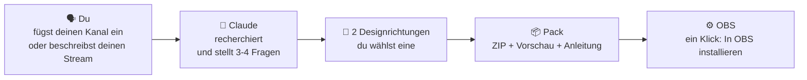
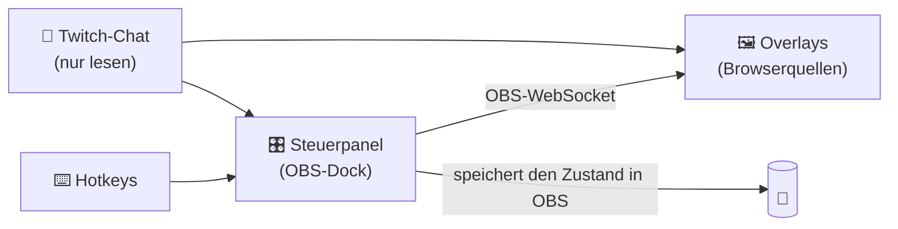

<div align="center">


# OverlayGenerator

**Ein Claude-Skill, der ein komplettes OBS-Overlay-Pack rund um *deinen* Kanal gestaltet, statt einer Vorlage mit deinem Namen drauf.**

[English](../../README.md) · [Español](README.es.md) · [Português (BR)](README.pt-BR.md) · [Français](README.fr.md) · **Deutsch** · [Italiano](README.it.md) · [日本語](README.ja.md) · [한국어](README.ko.md) · [简体中文](README.zh-CN.md)


[Was du bekommst](#-was-du-bekommst) · [Beispiele](#-keine-vorlagen) · [Installieren](#-skill-installieren) · [OBS einrichten](#️-obs-einrichten-schritt-für-schritt) · [FAQ](#-faq-und-problemlösung) · [Übersetzen](#-übersetzungen)

</div>

> [!IMPORTANT]
> **Vorabversion.** Die Architektur wurde in OBS 32 unter Windows getestet: Steuerpanel, Installation in OBS mit einem Klick, Hotkeys, Chatbefehle und Speicher. Der Skill selbst entsteht gerade. Klicke auf **Watch → Custom → Releases**, um von v1 zu erfahren. Die Schritte unten beschreiben, wie v1 funktionieren wird.

> [!NOTE]
> Dies ist eine Übersetzung der [englischen README](../../README.md) und kann etwas hinterherhinken.

---

## ✨ Was es macht

Du erzählst Claude von deinem Stream oder fügst einfach deinen Twitch-Kanal ein. Claude schaut sich an, was du spielst, wie du mit deinem Chat redest und was deinen Kanal zu *deinem* macht, und gestaltet daraus ein komplettes Overlay-Pack:

```text
Du:     Mach mir ein Overlay-Pack. Mein Kanal: twitch.tv/dein_kanal
Claude: Ich habe mir deine letzten Streams angesehen: vor allem Elden
        Ring, No-Hit-Runs, deutschsprachiger Chat, du zählst deine Tode
        von Hand im Titel... Hier sind zwei Richtungen. Welche passt zu dir?
```

Du wählst eine Richtung, Claude baut das Pack und du bekommst ein ZIP, fertig für OBS. Ohne Programmieren, ohne Vorlagen zum Ausfüllen.

## 🎁 Was du bekommst

| Was | Details |
|---|---|
| 🎬 **Szenen** | Gleich geht's los, Bin gleich zurück, Ende, dazu deine Hauptszenen (Spiel, Just Chatting, Coding, Nachrichtenstudio…) |
| 🔔 **Alerts** | Sub, Resub, Geschenk-Sub, Sub-Bombe, Raid und Bits, geschrieben in der Sprache und mit dem Humor deines Kanals |
| 💬 **Chat und Ziele** | Chat im Bild, Sub-Ziel und Kamerarahmen, passend zum Rest des Packs |
| 🧩 **Elemente für dein Format** | Todeszähler, Boss-Tracker, Themenplan, Nachrichtenticker, Tageszähler… was dein Stream wirklich braucht |
| 🎛️ **Steuerpanel in OBS** | Buttons, **Hotkeys** und **Chatbefehle für deine Mods**, um jedes Element live zu steuern |
| ⚙️ **Button „In OBS installieren“** | Legt Szenen und Quellen für dich an, schon richtig platziert |
| 👀 **Vorschau** | Doppelklick auf `preview.html` zeigt das ganze Pack, bevor du OBS anfasst |
| 📖 **Anleitung** | Eine einfache Schritt-für-Schritt-Anleitung in deiner Sprache |

## 🎨 Keine Vorlagen

Jedes Pack entsteht aus **der Idee hinter deinem Kanal**, nicht aus einem Stilmenü. Das hier sind Konzepte aus der Entwicklung der Methode. Dasselbe Ereignis, ein neuer Sub, sieht auf fünf Kanälen völlig anders aus:


| # | Idee des Kanals | Der Sub-Alert wird zu… |
|---|---|---|
| 1 | Ein Subathon ohne Ende, voller Partnercodes → **ein Kiosk, rund um die Uhr geöffnet** | Einem Kassenbon: „1 × Abo · Subathon +10:00 · Danke für Ihren Einkauf!“ |
| 2 | Ein Moderator mit eigenen Quizshows → **eine Retro-Spielshow im Fernsehen** | „Wir haben einen Sub!“ mit Glühbirnen, Konfetti und Gewinn |
| 3 | Talk-Streams, die eine Themenliste abarbeiten → **eine U-Bahn-Linie** | „Neuer Fahrgast · steigt in Linie 21 ein“; jedes Thema ist eine Station |
| 4 | Spielt ein Soulslike beim Gehen auf dem Laufband → **eine Pilgerreise** | „Ein neuer Pilger geht mit dir“ in einem Teerfleck |
| 5 | No-Hit-Runs, bei denen nur eine Zahl zählt → **die Null** | Einem schmalen Siegesbanner, das auch sagt, wie viel Zeit es dem Subathon hinzufügt |

<details>
<summary><b>🖼️ Die kompletten Szenen ansehen</b></summary>
<br>

| | |
|---|---|
|  **Kiosk**: Neonschild „GEÖFFNET“ mit Subathon-Timer, Kassenbon-Alerts und Preisschilder für die Partner |  **Spielshow**: Punktetafel für das Duo, Sub-Ziel als „Jackpot“ und Studio-Bauchbinde |
|  **U-Bahn-Linie**: die Themen des Tages als Stationen, LED-Anzeige „nächste Station“ und gelochter Fahrschein als Ziel |  **Pilgerreise**: jeder Tod macht das Laufband schneller, Schritte des Tages und Pilgerstempel als Sub-Ziel |
|  **No-Hit**: die 0 ist der Star, mit Versuch, Rekord und Boss; hält Abstand zum Spiel-HUD |  **…wenn du getroffen wirst**: die 0 wird zur roten 1, das Feuer geht aus und Alerts warten, bis der Boss vorbei ist |

<sub>Inoffizielle Konzepte auf Basis öffentlicher Kanalinformationen, nur zur Entwicklung und zum Testen der Methode erstellt. Keine Verbindung zu diesen Creators und nicht von ihnen unterstützt. „marta_dev“ ist eine erfundene Zuschauerin.</sub>

</details>

### Designregeln, die jedes Pack einhält

- 🎯 **Für deinen Kanal gemacht.** Jedes Element besteht einen einfachen Test: „Würde das auf einem anderen Kanal Sinn ergeben?“ Wenn ja, wird es neu gestaltet.
- 🕹️ **Respektiert das Spiel.** Elemente halten Abstand zum Spiel-HUD (Lebensleiste, Minikarte, Punktestand) und nehmen wenig Bildfläche ein.
- 🔠 **Auf dem Handy lesbar.** Große Schrift und starker Kontrast, automatisch in jeder Szene geprüft.
- 🧘 **Standardmäßig ruhig.** Nichts läuft in Endlosschleife; nur Ereignisse bewegen sich.
- ©️ **Nichts Offizielles.** Es darf an dein Spiel *erinnern*, nutzt aber nie Logos, Figuren, Artworks oder offizielle Schriften.
- 🌍 **In deiner Sprache.** Die Sprache des Packs wird aus deinem Kanal erkannt, und die Alerts klingen wie dein Chat.

---

## 🧠 So funktioniert es



In OBS nutzt das Pack **den eingebauten WebSocket von OBS**. Sonst musst du nichts installieren: kein Python, kein Server, kein Konto.



---

## 📋 Voraussetzungen

- **OBS Studio 28 oder neuer** (unter Windows getestet; macOS und Linux geplant)
- **Ein Claude-Konto** mit aktiviertem *Code execution and file creation* (verfügbar in Free, Pro, Max, Team und Enterprise)
- **Ein Twitch-Kanal** für Alerts und Chat (YouTube und Kick geplant)

## 📥 Skill installieren

> [!NOTE]
> Der Download steht unter [Releases](https://github.com/Ro0oman/OverlayGenerator-Claude-Skill/releases) bereit, sobald v1 erscheint.

### In der Claude-App (Web oder Desktop)

1. Lade `overlay-generator.zip` aus dem neuesten Release herunter. **Nicht entpacken.**
2. Öffne in Claude **Settings → Capabilities** und aktiviere **Code execution and file creation**.
3. Gehe zu **Customize → Skills**, klicke auf **+** und dann auf **+ Create skill → Upload a skill**.
4. Wähle das ZIP aus und prüfe, ob der Skill **eingeschaltet** ist.

In Team- und Enterprise-Plänen muss eventuell zuerst ein Admin Skills erlauben. Siehe [Use skills in Claude](https://support.claude.com/en/articles/12512180-use-skills-in-claude).

> Die Menünamen sind auf Englisch; deine App zeigt sie vielleicht auf Deutsch an.

### In Claude Code

Skills, die in deinem Claude-Konto aktiviert sind, erscheinen automatisch in Claude Code (prüfe es mit `/skills`). Für eine lokale Installation entpacke ihn nach `~/.claude/skills/`:

```bash
unzip overlay-generator.zip -d ~/.claude/skills/
```

## 🚀 Dein Pack erstellen

Starte einen neuen Chat und schreib etwa:

> *Mach mir ein OBS-Overlay-Pack. Mein Kanal: twitch.tv/dein_kanal*

oder ohne Kanal:

> *Ich streame Minecraft Hardcore auf Deutsch, entspannte Stimmung. Ich will einen Tageszähler und ein Ziel von 10 Subs.*

Claude wird:

1. **Dich um 1–2 Screenshots deines Streams bitten.** Das ist optional, macht aber einen großen Unterschied: Man sieht, wo deine Kamera und das Spiel-HUD sind.
2. Zusammenfassen, was es gefunden hat, und ein paar kurze Fragen stellen (Kamera oder VTuber, Sub-Ziel, Sponsoren, Themen, die du meiden willst).
3. Dir **zwei Designrichtungen** mit Vorschau zeigen. Du wählst eine oder wünschst dir Änderungen.
4. Dir **das ZIP des Packs** geben.

---

## 🛠️ OBS einrichten, Schritt für Schritt

Das dauert etwa 5 Minuten und musst du nur einmal machen.

> Die OBS-Menünamen sind auf Englisch; dein OBS zeigt sie vielleicht auf Deutsch an.

### 1. Das Pack in einen festen Ordner entpacken

Zum Beispiel nach `C:\Overlays\mein-pack`.

> [!WARNING]
> **Nicht** in Downloads, **nicht** im ZIP selbst und **nicht** in einem mit OneDrive oder Dropbox synchronisierten Ordner. OBS zeigt weiter auf diesen Ordner; wird er verschoben, funktionieren die Overlays nicht mehr.

### 2. Den OBS-WebSocket aktivieren

1. Öffne in OBS **Tools → WebSocket Server Settings**.
2. Setze den Haken bei **Enable WebSocket server**.
3. Lass **Enable Authentication** aktiviert und klicke auf **Show Connect Info**, um das **Passwort** zu kopieren.
4. Klicke auf **OK**.

### 3. Das Steuerpanel als Dock hinzufügen

1. Öffne **Docks → Custom Browser Docks…**
2. Gib ihm einen Namen, z. B. `Overlay-Panel`.
3. Füge bei URL die Adresse von `panel.html` aus deinem Ordner ein, z. B. `file:///C:/Overlays/mein-pack/panel.html`.
4. Klicke auf **Apply**. Das Panel erscheint in OBS und du kannst es beliebig verschieben.

### 4. Verbinden und installieren

Füge das WebSocket-Passwort im Panel ein, klicke auf **Verbinden** und dann auf **⚙ In OBS installieren**.

Das Panel legt alle Szenen und Quellen für dich an, schon richtig platziert. Du kannst den Button gefahrlos erneut drücken: Er repariert oder aktualisiert, ohne etwas doppelt anzulegen.

<p align="center"></p>
<p align="center"><sub>Prototyp des Panels in OBS 32 direkt nach „In OBS installieren“. Das endgültige Panel kann anders aussehen.</sub></p>

### 5. Optional: Hotkeys, damit du das Spiel nie verlassen musst

Manche Elemente (Todeszähler, „nächster Boss“, „nächstes Thema“…) bringen Hotkeys mit.

1. Öffne **Settings → Hotkeys**.
2. Suche die Einträge **OVG ·** des Packs.
3. Lege eine Taste auf **Show 'OVG · …'** (z. B. F9 für +1). Lass **Hide** leer.
4. Klicke auf **OK**. Die Taste funktioniert in jeder Szene, auch mitten im Spiel.

<table><tr>
<td width="55%"></td>
<td><br><sub>Leg eine Taste auf <b>Show</b>, drück sie im Spiel, und das Overlay aktualisiert sich.</sub></td>
</tr></table>

> [!TIP]
> Hotkeys funktionieren auch mit einem **Stream Deck** über dessen OBS-Hotkey-Aktion.

### 6. Optional: Chatbefehle für deine Mods

Gib im Panel deinen Kanalnamen ein und klicke auf **Chat mithören**. Ab dann können deine Mods (und du) die Befehle des Packs nutzen, etwa `!tod` oder `!weiter`. Befehle vom restlichen Chat werden ignoriert.

### 7. Live gehen

> [!CAUTION]
> **Lass das Panel während des Streams offen.** Es ist das Gehirn des Packs. Du kannst das Dock minimieren, aber schließ es nicht. Wird es geschlossen, behalten die Overlays den letzten Stand und zeigen einen kleinen Hinweis **„Panel geschlossen“**, damit sogar deine Zuschauer dir Bescheid sagen können.

---

## 🔄 Pack aktualisieren oder ändern

Schick Claude das ZIP deines Packs (oder nur die `pack.json`) und sag, was du willst: *„aktualisier es“*, *„füg einen Boss-Tracker hinzu“*, *„mach die Alerts auffälliger“*.

1. Claude baut das Pack mit **denselben Dateinamen** neu.
2. Entpacke es **über** den alten Ordner.
3. Gibt es neue Elemente, klicke noch einmal auf **In OBS installieren**.

Deine Zähler und Einstellungen bleiben erhalten.

## ❓ FAQ und Problemlösung

<details>
<summary><b>Das Overlay ist leer oder reagiert nicht</b></summary>

- Prüfe, ob das Panel **Mit OBS verbunden** anzeigt.
- Wenn du eine Quelle von Hand hinzugefügt hast: In den Eigenschaften der Browserquelle **„Local file“ abwählen** und die komplette `file:///…`-Adresse einfügen. Mit aktiviertem „Local file“ gehen die Einstellungen in der Adresse verloren.
- Rechtsklick auf die Quelle → **Refresh**.
</details>

<details>
<summary><b>Im Stream erscheint „Panel geschlossen“</b></summary>

Das Dock des Steuerpanels wurde geschlossen. Öffne es wieder über **Docks**, und der Hinweis verschwindet nach ein paar Sekunden.
</details>

<details>
<summary><b>Ein Hotkey funktioniert in einem Spiel nicht</b></summary>

Manche Spiele im **exklusiven Vollbild** oder mit strengem Anti-Cheat schlucken Tastendrücke. Stell das Spiel auf **randloses Fenster** um. Hilft das nicht, nimm den Chatbefehl oder ein Stream Deck.
</details>

<details>
<summary><b>Ich habe den Browser-Cache von OBS geleert. Sind meine Zähler weg?</b></summary>

Nein. Das Panel speichert eine Kopie seines Zustands in deinem OBS-Profil und stellt sie automatisch wieder her. Das wurde mit geleertem Cache und OBS-Neustarts getestet.
</details>

<details>
<summary><b>Ist das WebSocket-Passwort in den Overlay-Adressen sicher?</b></summary>

Die Overlays brauchen es, um mit OBS zu sprechen, deshalb steht es in ihrer Adresse. Es gibt nur Zugriff von deinem eigenen Rechner oder lokalen Netzwerk aus. Wenn du glaubst, es ist durchgesickert, erzeuge unter **Tools → WebSocket Server Settings** ein neues, trag es im Panel ein und klicke noch einmal auf **In OBS installieren**: Alle Adressen werden neu geschrieben.
</details>

<details>
<summary><b>Gibt es Follows, Spenden oder Kanalpunkte?</b></summary>

Von sich aus noch nicht. Das Pack liest den Twitch-Chat anonym, und das deckt Subs, Resubs, Geschenk-Subs, Sub-Bomben, Raids und Bits ab. Follows, Spenden und Kanalpunkte erfordern einen Login; die Anleitung zeigt dir, wie du nur diese Alerts in StreamElements oder Streamlabs behältst, passend gestaltet.
</details>

<details>
<summary><b>Kann ich es auf YouTube oder Kick nutzen?</b></summary>

Szenen, Panel und Elemente funktionieren überall, wo OBS läuft. Alerts und Chat gibt es in v1 nur für Twitch; YouTube und Kick sind geplant.
</details>

## 🔒 Datenschutz

- Keine Konten, keine Server, kein Tracking. Alles läuft in **deinem OBS** auf **deinem Rechner**.
- Der Twitch-Chat wird **anonym** gelesen, so wie ihn ein nicht angemeldeter Zuschauer sieht.
- Chatnachrichten werden immer als Text angezeigt, nie als Code.

## 🗺️ Roadmap

- [x] Architektur in OBS 32 getestet: Panel über WebSocket, Installation mit einem Klick, Hotkeys, Mod-Befehle, Speicher übersteht geleerten Cache und Neustarts
- [x] Designmethode an echten Kanälen getestet, mit automatischen Prüfungen auf HUD-Überlappung, Bildfläche, Schriftgröße und Kontrast
- [ ] **v1**: der Skill, die Engine, der Pack-Builder und der Validator
- [ ] YouTube und Kick
- [ ] Alerts für Follows, Spenden und Kanalpunkte
- [ ] Tests unter macOS und Linux

## 🌍 Übersetzungen

Diese README gibt es in mehreren Sprachen. Die nicht englischen Versionen sind aus dem Englischen übersetzt und können etwas hinterherhinken. Wenn du einen Fehler findest oder deine Sprache ergänzen willst, lies **[wie man übersetzt](../TRANSLATING.md)**. Ein Pull Request genügt.

Die Overlay-Packs selbst werden in **jeder Sprache** erzeugt, die dein Kanal spricht.

## 🤝 Mitmachen

Issues und Ideen sind willkommen, besonders:

- Screenshots deines Stream-Layouts (sie helfen, für jedes Spiel eine Standard-HUD-Karte zu erstellen),
- Stream-Formate, die die Elemente noch nicht abdecken,
- Korrekturen an Übersetzungen.

---

<div align="center">
<sub>Erstellt von <a href="https://github.com/Ro0oman">Ro0oman</a> mit Claude. Keine Verbindung zu OBS Project, Twitch oder Anthropic.</sub>
</div>
