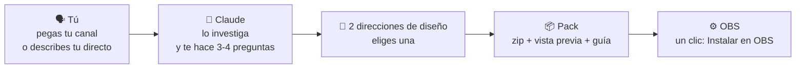
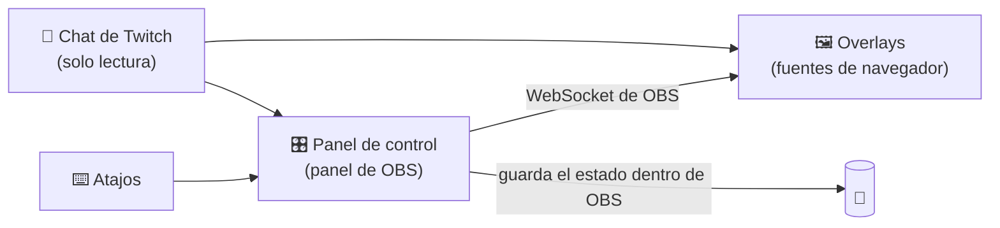

<div align="center">


# OverlayGenerator

**Una skill de Claude que diseña un pack completo de overlays para OBS a partir de *tu* canal, no una plantilla con tu nombre encima.**

[English](../../README.md) · **Español** · [Português (BR)](README.pt-BR.md) · [Français](README.fr.md) · [Deutsch](README.de.md) · [Italiano](README.it.md) · [日本語](README.ja.md) · [한국어](README.ko.md) · [简体中文](README.zh-CN.md)


[Qué recibes](#-qué-recibes) · [Ejemplos](#-nada-de-plantillas) · [Alertas](#-alertas-en-acción) · [Panel](#️-el-panel-de-control) · [Instalar](#-instalar-la-skill) · [Configurar OBS](#️-configurar-obs-paso-a-paso) · [Dudas](#-dudas-y-problemas) · [Traducir](#-traducciones)

</div>

> [!IMPORTANT]
> **v1 beta.** Aquí están la skill, el motor y un pack de ejemplo completo. Todo está probado contra un OBS simulado, y lo esencial (panel, instalación con un clic, atajos, comandos de chat y memoria) en un OBS 32 real con Windows. ¿Has encontrado un fallo? [Abre una issue](https://github.com/Ro0oman/OverlayGenerator-Claude-Skill/issues).

---

## ✨ Qué hace

Le cuentas a Claude cómo son tus directos, o simplemente pegas tu canal de Twitch. Claude mira a qué juegas, cómo hablas con tu chat y qué hace que tu canal sea *tuyo*, y con eso diseña un pack de overlays completo:

```text
Tú:     Hazme un pack de overlays. Mi canal es twitch.tv/tu_canal
Claude: He mirado tus últimos directos: sobre todo Elden Ring, partidas
        sin recibir golpes, chat en español, cuentas las muertes a mano
        en el título... Te propongo dos direcciones. ¿Cuál va más contigo?
```

Eliges una dirección, Claude monta el pack y te llevas un zip listo para OBS. Sin programar y sin rellenar plantillas.

## 🎁 Qué recibes

| Qué | Detalle |
|---|---|
| 🎬 **Escenas** | Empezando, Vuelvo enseguida, Fin, y tus escenas principales (juego, charla, programación, noticiero…) |
| 🔔 **Alertas** | Sub, resub, sub regalada, lluvia de subs, raid y bits, escritas en el idioma y el humor de tu canal |
| 💬 **Chat y metas** | Chat en pantalla, meta de subs y marco de cámara a juego con el resto del pack |
| 🧩 **Piezas hechas para tu formato** | Contador de muertes, jefes, agenda de temas, rótulos de noticiero, contador de días… lo que tu directo necesite de verdad |
| 🎛️ **Panel de control dentro de OBS** | Botones, **atajos de teclado** y **comandos de chat para tus mods** para mover cada pieza en directo |
| ⚙️ **Botón "Instalar en OBS"** | Crea las escenas y las fuentes por ti, ya colocadas |
| 👀 **Vista previa** | Doble clic en `vista-previa.html` y ves el pack entero antes de tocar OBS |
| 📖 **Guía** | Una guía paso a paso, sencilla y en tu idioma |

## 🎨 Nada de plantillas

Cada pack sale de **la idea de tu canal**, no de un menú de estilos. Estos son conceptos hechos mientras se desarrollaba el método. El mismo evento, un sub nuevo, se ve completamente distinto en cinco canales:


| # | Idea del canal | La alerta de sub se convierte en… |
|---|---|---|
| 1 | Un extensible que no acaba nunca, lleno de códigos de patrocinio → **una tiendita abierta 24 h** | Un ticket de compra: "1 × suscripción · extensible +10:00 · ¡Gracias por su compra!" |
| 2 | Un presentador con sus propios concursos → **un plató de concurso de la tele de siempre** | "¡Tenemos sub!" con bombillas, confeti y premio |
| 3 | Directos de charla que van por una lista de temas → **una línea de metro** | "Nuevo abono · sube a la Línea 21"; cada tema es una estación |
| 4 | Juega a un soulslike caminando en una cinta → **una peregrinación** | "Un nuevo peregrino camina contigo" en una mancha de brea |
| 5 | Partidas sin recibir golpes, donde solo importa un número → **el cero** | Una franja de victoria fina que además dice cuánto suma al extensible |

<details>
<summary><b>🖼️ Ver las escenas completas</b></summary>
<br>

| | |
|---|---|
|  **Tiendita**: neón "ABIERTO" con el tiempo del extensible, alertas en ticket y etiquetas de precio con los patrocinios |  **Concurso**: marcador del dúo, meta de subs como "el bote" y rótulo de plató |
|  **Línea de metro**: los temas del día como estaciones, panel LED de "próxima estación" y billete perforado como meta |  **Peregrinación**: cada muerte acelera la cinta, pasos del día y sellos del peregrino como meta de subs |
|  **Sin golpes**: el 0 es el protagonista, con intento, récord y jefe; no pisa el HUD del juego |  **…cuando te dan**: el 0 pasa a un 1 rojo, la hoguera se apaga y las alertas esperan a que acabe el jefe |

<sub>Conceptos no oficiales basados en información pública de los canales, hechos solo para desarrollar y probar el método. Sin relación ni respaldo de estos creadores. "marta_dev" es una espectadora inventada.</sub>

</details>

### 🔔 Alertas en acción

Cada pack anima sus alertas a su manera. Mismo espectador, mismo sub, seis ambientes:

<table><tr><td width="50%" align="center"><br><b>Tiendita</b>: se imprime como un ticket de caja</td><td width="50%" align="center"><br><b>Concurso</b>: bombillas, confeti y premio</td></tr><tr><td width="50%" align="center"><br><b>Línea de metro</b>: entra como un rótulo de andén</td><td width="50%" align="center"><br><b>Peregrinación</b>: la brea se filtra por la piedra</td></tr><tr><td width="50%" align="center"><br><b>Sin golpes</b>: una franja fina que no estorba en el combate</td><td width="50%" align="center"><br><b>…y el golpe</b>: el cero se pone rojo y la hoguera se apaga</td></tr></table>

<sub>Son los mismos conceptos no oficiales de arriba. En tu pack, cada alerta se diseña para tu canal.</sub>

### Reglas de diseño que cumple cada pack

- 🎯 **Hecho para tu canal.** Cada pieza pasa una prueba sencilla: "¿tendría sentido en otro canal?". Si la respuesta es sí, se rediseña.
- 🕹️ **Respeta el juego.** Las piezas se apartan del HUD del juego (vida, minimapa, marcador) y ocupan poca pantalla.
- 🔠 **Se lee en el móvil.** Texto grande y buen contraste, comprobados automáticamente en cada escena.
- 🧘 **Tranquilo por defecto.** Nada se mueve en bucle; solo se mueven los eventos.
- ©️ **Nada oficial.** Puede *evocar* tu juego, pero nunca usa logos, personajes, arte ni fuentes oficiales.
- 🌍 **En tu idioma.** El idioma del pack se deduce de tu canal, y las alertas suenan como tu chat.

## 🎛️ El panel de control

Cada pack trae su propio panel, metido dentro de OBS. Claude solo pone en él lo que usa tu directo: los botones, atajos y comandos de chat de *tus* piezas.

<p align="center"></p>
<p align="center"><sub>Pulsas <b>F9</b> jugando, o un mod escribe <code>!turb</code>: suben las turbulencias. <b>Final approach</b> retiene las alertas durante un jefe; <b>Undo</b> corrige un despiste.</sub></p>

<table><tr><td width="33%" valign="top"><br><b>En directo</b>: Cambia de escena y maneja cada pieza. Cada botón enseña su atajo y su comando de chat.</td><td width="33%" valign="top"><br><b>Alertas</b>: Prueba cada alerta, actívalas o desactívalas y retenlas durante los jefes.</td><td width="33%" valign="top"><br><b>Chat</b>: Los comandos y quién puede usarlos. Los de quien no es mod se ignoran y quedan apuntados.</td></tr></table>

<details>
<summary><b>Más: atajos y ajustes</b></summary>
<br>

<table><tr><td width="50%" valign="top"><br><b>Atajos</b>: Cada tecla, la entrada de OBS que usa y cuándo se pulsó por última vez.</td><td width="50%" valign="top"><br><b>Ajustes</b>: Conexión, instalar o reparar con un clic, copias de seguridad y cómo actualizar el pack.</td></tr></table>

</details>

<sub>El panel de la v1 en modo demo, con un canal inventado. Las tarjetas, botones y comandos cambian en cada pack.</sub>

---

## 🧠 Cómo funciona



Dentro de OBS, el pack usa **el WebSocket que ya trae OBS**. No hay que instalar nada más: ni Python, ni servidor, ni cuentas.



---

## 📋 Requisitos

- **OBS Studio 28 o posterior** (probado en Windows; macOS y Linux, más adelante)
- **Una cuenta de Claude** con *Ejecución de código y creación de archivos* activada (disponible en Free, Pro, Max, Team y Enterprise)
- **Un canal de Twitch** para las alertas y el chat (YouTube y Kick, más adelante)

## 📥 Instalar la skill

> [!NOTE]
> Descarga `overlay-generator.zip` de la [última versión](https://github.com/Ro0oman/OverlayGenerator-Claude-Skill/releases/latest).

### En la app de Claude (web o escritorio)

1. Descarga `overlay-generator.zip` de la última versión. **No lo descomprimas.**
2. En Claude, abre **Ajustes → Funciones** (*Settings → Capabilities*) y activa **Ejecución de código y creación de archivos**.
3. Ve a **Personalizar → Skills** (*Customize → Skills*), pulsa **+** y luego **+ Crear skill → Subir una skill**.
4. Elige el zip y comprueba que la skill está **activada**.

En los planes Team y Enterprise puede que un administrador tenga que permitir las skills antes. Más información en [Usar skills en Claude](https://support.claude.com/en/articles/12512180-use-skills-in-claude).

> Los nombres de los menús pueden variar un poco según el idioma de tu app.

### En Claude Code

Las skills activadas en tu cuenta de Claude aparecen solas en Claude Code (compruébalo con `/skills`). Si prefieres instalarla en local, descomprímela en `~/.claude/skills/`:

```bash
unzip overlay-generator.zip -d ~/.claude/skills/
```

O instálala como plugin, directamente desde este repositorio:

```text
/plugin install overlay-generator --marketplace Ro0oman/OverlayGenerator-Claude-Skill
```

## 🚀 Crea tu pack

Abre un chat nuevo y di algo como:

> *Hazme un pack de overlays para OBS. Mi canal es twitch.tv/tu_canal*

o, sin canal:

> *Hago directos de Minecraft hardcore en español, rollo tranquilo. Quiero un contador de días y una meta de 10 subs.*

Claude:

1. **Te pedirá 1–2 capturas de tu directo.** Es opcional, pero cambia mucho el resultado: así sabe dónde están tu cámara y el HUD del juego.
2. Te resumirá lo que ha encontrado y te hará unas preguntas cortas (cámara o VTuber, meta de subs, patrocinios, temas que prefieres evitar).
3. Te enseñará **dos direcciones de diseño** con vista previa. Eliges una o pides cambios.
4. Te dará **el zip del pack**.

---

## 🛠️ Configurar OBS, paso a paso

Son unos 5 minutos y solo se hace una vez.

### 1. Descomprime el pack en una carpeta fija

Por ejemplo, en `C:\Overlays\mi-pack`.

> [!WARNING]
> **Ni** en Descargas, **ni** dentro del zip, **ni** en una carpeta sincronizada con OneDrive o Dropbox. OBS sigue apuntando a esa carpeta; si la mueves, los overlays dejan de funcionar.

### 2. Activa el WebSocket de OBS

1. En OBS, abre **Herramientas → Ajustes del servidor WebSocket**.
2. Marca **Habilitar servidor WebSocket**.
3. Deja marcada la **autenticación** y pulsa **Mostrar información de conexión** para copiar la **contraseña**.
4. Pulsa **Aceptar**.

### 3. Añade el panel de control a OBS

1. Abre **Paneles → Paneles de navegador personalizados…**
2. Ponle un nombre, por ejemplo `Panel overlay`.
3. En URL, pega la dirección de `panel.html` dentro de tu carpeta, por ejemplo `file:///C:/Overlays/mi-pack/panel.html`.
4. Pulsa **Aplicar**. El panel aparece dentro de OBS y puedes arrastrarlo donde quieras.

### 4. Conecta e instala

Pega la contraseña del WebSocket en el panel, pulsa **Conectar** y luego **⚙ Instalar en OBS**.

El panel crea todas las escenas y fuentes por ti, ya colocadas. Puedes volver a pulsarlo sin miedo: repara o actualiza sin duplicar nada.

<p align="center"></p>
<p align="center"><sub>Prototipo del panel en OBS 32 justo después de "Instalar en OBS". El aspecto del panel final puede cambiar.</sub></p>

### 5. Opcional: atajos de teclado, para no salir del juego

Algunas piezas (contador de muertes, "siguiente jefe", "siguiente tema"…) vienen con atajos.

1. Abre **Archivo → Ajustes → Atajos**.
2. Busca las entradas **OVG ·** del pack.
3. Pon una tecla en **Mostrar 'OVG · …'** (por ejemplo, F9 para +1). Deja **Ocultar** vacío.
4. Pulsa **Aceptar**. La tecla funciona desde cualquier escena, también con el juego delante.

<table><tr>
<td width="55%"></td>
<td><br><sub>Pon una tecla en <b>Mostrar</b>, púlsala en el juego y el overlay se actualiza.</sub></td>
</tr></table>

> [!TIP]
> Los atajos también funcionan con un **Stream Deck**, con su acción de atajo de OBS.

### 6. Opcional: comandos de chat para tus mods

Escribe el nombre de tu canal en el panel y pulsa **Escuchar chat**. A partir de ahí, tus mods (y tú) podéis usar los comandos que trae tu pack, como `!muerte` o `!siguiente`. Los del resto del chat se ignoran.

### 7. A emitir

> [!CAUTION]
> **Deja el panel abierto mientras emites.** Es el cerebro del pack. Puedes minimizarlo, pero no lo cierres. Si se cierra, los overlays mantienen el último estado y muestran un pequeño aviso de **"Panel cerrado"**, para que hasta tu público pueda avisarte.

---

## 🔄 Actualizar o cambiar tu pack

Pásale a Claude el zip de tu pack (o solo su `pack.json`) y dile qué quieres: *"actualízalo"*, *"añade un contador de jefes"*, *"haz las alertas más llamativas"*.

1. Claude rehace el pack con **los mismos nombres de archivo**.
2. Descomprímelo **encima** de la carpeta anterior.
3. Si hay piezas nuevas, vuelve a pulsar **Instalar en OBS**.

Tus contadores y tu configuración se conservan.

## ❓ Dudas y problemas

<details>
<summary><b>El overlay sale en blanco o no reacciona</b></summary>

- Comprueba que el panel dice **Conectado a OBS**.
- Si añadiste una fuente a mano: en las propiedades de la fuente de navegador, **desmarca "Archivo local"** y pega la dirección completa `file:///…`. Con "Archivo local" marcado se pierden los ajustes que van en la dirección.
- Clic derecho en la fuente → **Actualizar**.
</details>

<details>
<summary><b>Sale "Panel cerrado" en el directo</b></summary>

Se ha cerrado el panel de control. Ábrelo otra vez desde **Paneles** y el aviso desaparece en unos segundos.
</details>

<details>
<summary><b>Un atajo no funciona dentro de un juego</b></summary>

Algunos juegos en **pantalla completa exclusiva**, o con antitrampas estrictos, se quedan con las teclas. Pon el juego en **ventana sin bordes**. Si aun así no va, usa el comando de chat o un Stream Deck.
</details>

<details>
<summary><b>He limpiado la caché del navegador de OBS. ¿He perdido los contadores?</b></summary>

No. El panel guarda una copia del estado dentro de tu perfil de OBS y la recupera solo. Está probado limpiando la caché y reiniciando OBS.
</details>

<details>
<summary><b>¿Es seguro que la contraseña del WebSocket vaya en las direcciones de los overlays?</b></summary>

Los overlays la necesitan para hablar con OBS, así que va en su dirección. Solo da acceso desde tu ordenador o tu red local. Si crees que se ha filtrado, genera otra en **Herramientas → Ajustes del servidor WebSocket**, ponla en el panel y pulsa otra vez **Instalar en OBS**: se reescriben todas las direcciones.
</details>

<details>
<summary><b>¿Sirve para follows, donaciones o puntos del canal?</b></summary>

Por sí solo, todavía no. El pack lee el chat de Twitch de forma anónima, y eso cubre subs, resubs, regalos, lluvias de subs, raids y bits. Los follows, las donaciones y los puntos del canal necesitan iniciar sesión, así que la guía te explica cómo dejar solo esas alertas en StreamElements o Streamlabs, con un estilo a juego.
</details>

<details>
<summary><b>¿Puedo usarlo en YouTube o Kick?</b></summary>

Las escenas, el panel y las piezas funcionan en cualquier sitio donde funcione OBS. Las alertas y el chat son solo de Twitch en la v1; YouTube y Kick están previstos.
</details>

## 🔒 Privacidad

- Sin cuentas, sin servidores y sin rastreo. Todo funciona en **tu OBS**, en **tu ordenador**.
- El chat de Twitch se lee **de forma anónima**, igual que lo ve alguien sin iniciar sesión.
- Los mensajes del chat se muestran siempre como texto, nunca como código.

## 🗺️ Hoja de ruta

- [x] Arquitectura probada en OBS 32: panel por WebSocket, instalación con un clic, atajos, comandos para mods y memoria que sobrevive a limpiar la caché y a reiniciar
- [x] Método de diseño probado con canales reales, con comprobaciones automáticas de solapes con el HUD, espacio en pantalla, tamaño de texto y contraste
- [x] **v1**: la skill, el motor, el generador de packs y el validador
- [ ] YouTube y Kick
- [ ] Alertas de follows, donaciones y puntos del canal
- [ ] Pruebas en macOS y Linux

## 🌍 Traducciones

Este README está en varios idiomas. Las versiones que no están en inglés se traducen del inglés y pueden ir un poco por detrás. Si ves un error o quieres añadir tu idioma, mira **[cómo traducir](../TRANSLATING.md)**. Basta con un pull request.

Los packs de overlays se generan en **cualquier idioma** que use tu canal.

## 🤝 Contribuir

Se agradecen issues e ideas, sobre todo:

- capturas de la distribución de tu directo (ayudan a crear el mapa de HUD por defecto de cada juego),
- formatos de directo que las piezas aún no cubren,
- correcciones de traducción.

---

<div align="center">
<sub>Hecho por <a href="https://github.com/Ro0oman">Ro0oman</a> con Claude. Sin relación con OBS Project, Twitch ni Anthropic.</sub>
</div>
