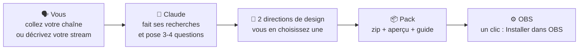
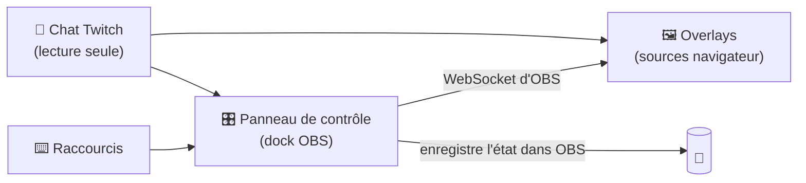

<div align="center">


# OverlayGenerator

**Une skill Claude qui conçoit un pack complet d'overlays OBS à partir de *votre* chaîne, et pas un modèle avec votre nom dessus.**

[English](../../README.md) · [Español](README.es.md) · [Português (BR)](README.pt-BR.md) · **Français** · [Deutsch](README.de.md) · [Italiano](README.it.md) · [日本語](README.ja.md) · [한국어](README.ko.md) · [简体中文](README.zh-CN.md)


[](https://overlays.romandev.app/fr/) [](https://overlays.romandev.app/demo/)

[Ce que vous obtenez](#-ce-que-vous-obtenez) · [Exemples](#-pas-de-modèles) · [Alertes](#-les-alertes-en-action) · [Panneau](#️-le-panneau-de-contrôle) · [Installer](#-installer-la-skill) · [Configurer OBS](#️-configurer-obs-étape-par-étape) · [FAQ](#-faq-et-dépannage) · [Traduire](#-traductions)

</div>

> [!IMPORTANT]
> **v1 bêta.** La skill, le moteur et un pack d'exemple complet sont là. Tout a été testé contre un OBS simulé, et l'essentiel (panneau, installation en un clic, raccourcis, commandes de chat, mémoire) dans un vrai OBS 32 sous Windows. Un bug ? [Ouvrez une issue](https://github.com/Ro0oman/OverlayGenerator-Claude-Skill/issues).

> [!NOTE]
> Ceci est une traduction du [README en anglais](../../README.md). Elle peut avoir un peu de retard.

---

## ✨ Ce que ça fait

Vous décrivez vos streams à Claude, ou vous collez simplement votre chaîne Twitch. Claude regarde à quoi vous jouez, comment vous parlez à votre chat et ce qui rend votre chaîne *unique*, puis conçoit un pack d'overlays complet autour de ça :

```text
Vous :   Fais-moi un pack d'overlays. Ma chaîne : twitch.tv/votre_chaine
Claude : J'ai regardé tes derniers streams : surtout Elden Ring, des runs
         sans prendre de coup, un chat francophone, tu comptes tes morts
         à la main dans le titre... Voici deux directions. Laquelle te
         ressemble le plus ?
```

Vous choisissez une direction, Claude construit le pack et vous récupérez un zip prêt pour OBS. Sans coder, sans modèle à remplir.

## 🎁 Ce que vous obtenez

| Quoi | Détails |
|---|---|
| 🎬 **Scènes** | Ça commence bientôt, Je reviens, Fin, plus vos scènes principales (jeu, discussion, code, journal télévisé…) |
| 🔔 **Alertes** | Sub, resub, sub offert, pluie de subs, raid et bits, écrites dans la langue et avec l'humour de votre chaîne |
| 💬 **Chat et objectifs** | Chat à l'écran, objectif de subs et cadre de caméra assortis au reste du pack |
| 🧩 **Des éléments faits pour votre format** | Compteur de morts, suivi des boss, programme des sujets, bandeau d'info, compteur de jours… ce dont votre stream a vraiment besoin |
| 🎛️ **Panneau de contrôle dans OBS** | Boutons, **raccourcis clavier** et **commandes de chat pour vos modos** pour piloter chaque élément en direct |
| ⚙️ **Bouton « Installer dans OBS »** | Crée les scènes et les sources pour vous, déjà placées |
| 👀 **Aperçu** | Double-cliquez sur `preview.html` pour voir tout le pack avant de toucher à OBS |
| 📖 **Guide** | Un guide pas à pas, simple et dans votre langue |

## 🎨 Pas de modèles

Chaque pack part de **l'idée de votre chaîne**, pas d'un menu de styles. Voici des concepts réalisés pendant le développement de la méthode. Le même événement, un nouvel abonné, est complètement différent sur cinq chaînes :


| # | Idée de la chaîne | L'alerte de sub devient… |
|---|---|---|
| 1 | Un subathon sans fin, plein de codes partenaires → **une supérette ouverte 24 h/24** | Un ticket de caisse : « 1 × abonnement · subathon +10:00 · Merci de votre achat ! » |
| 2 | Un animateur qui a ses propres jeux-concours → **un jeu télévisé rétro** | « On a un sub ! » avec ampoules, confettis et lot à gagner |
| 3 | Des streams discussion qui suivent une liste de sujets → **une ligne de métro** | « Nouvel abonné · monte sur la ligne 21 » ; chaque sujet est une station |
| 4 | Joue à un soulslike en marchant sur un tapis → **un pèlerinage** | « Un nouveau pèlerin marche avec toi » dans une tache de goudron |
| 5 | Des runs sans prendre de coup, où un seul chiffre compte → **le zéro** | Un fin bandeau de victoire qui indique aussi le temps ajouté au subathon |

<details>
<summary><b>🖼️ Voir les scènes complètes</b></summary>
<br>

| | |
|---|---|
|  **Supérette** : néon « OUVERT » avec le chrono du subathon, alertes en ticket et étiquettes de prix pour les partenaires |  **Jeu télévisé** : tableau des scores du duo, objectif de subs façon « cagnotte » et bandeau de plateau |
|  **Ligne de métro** : les sujets du jour comme stations, panneau LED « prochaine station » et ticket poinçonné comme objectif |  **Pèlerinage** : chaque mort accélère le tapis, pas du jour et sceaux du pèlerin comme objectif de subs |
|  **Sans coup** : le 0 est la star, avec tentative, record et boss ; il évite le HUD du jeu |  **…quand vous êtes touché** : le 0 devient un 1 rouge, le feu s'éteint et les alertes attendent la fin du boss |

<sub>Concepts non officiels basés sur des informations publiques des chaînes, réalisés uniquement pour développer et tester la méthode. Sans lien ni soutien de ces créateurs. « marta_dev » est une spectatrice inventée.</sub>

</details>

### 🔔 Les alertes en action

Chaque pack anime ses alertes à sa façon. Même spectateur, même sub, six ambiances :

<table><tr><td width="50%" align="center"><br><b>Supérette</b>: imprimée comme un ticket de caisse</td><td width="50%" align="center"><br><b>Jeu télévisé</b>: ampoules, confettis et lot à gagner</td></tr><tr><td width="50%" align="center"><br><b>Ligne de métro</b>: arrive comme un panneau de quai</td><td width="50%" align="center"><br><b>Pèlerinage</b>: le goudron suinte à travers la pierre</td></tr><tr><td width="50%" align="center"><br><b>Sans coup</b>: un fin bandeau qui ne gêne pas le combat</td><td width="50%" align="center"><br><b>…et le coup</b>: le zéro devient rouge et le feu s'éteint</td></tr></table>

<sub>Ce sont les mêmes concepts non officiels que plus haut. Dans votre pack, chaque alerte est conçue pour votre chaîne.</sub>

### Les règles de design de chaque pack

- 🎯 **Fait pour votre chaîne.** Chaque élément passe un test simple : « est-ce que ça aurait du sens sur une autre chaîne ? ». Si oui, il est repensé.
- 🕹️ **Respecte le jeu.** Les éléments évitent le HUD du jeu (vie, minicarte, score) et prennent peu de place à l'écran.
- 🔠 **Lisible sur mobile.** Texte grand et bon contraste, vérifiés automatiquement sur chaque scène.
- 🧘 **Calme par défaut.** Rien ne tourne en boucle ; seuls les événements bougent.
- ©️ **Rien d'officiel.** Le pack peut *évoquer* votre jeu, mais n'utilise jamais de logos, personnages, illustrations ou polices officielles.
- 🌍 **Dans votre langue.** La langue du pack est détectée à partir de votre chaîne, et les alertes parlent comme votre chat.

## 🎛️ Le panneau de contrôle

Chaque pack a son propre panneau, intégré à OBS. Claude n'y met que ce que votre stream utilise : les boutons, raccourcis et commandes de chat de *vos* éléments.

<p align="center"></p>
<p align="center"><sub>Appuyez sur <b>F9</b> en jeu, ou un modo tape <code>!turb</code> : la turbulence monte. <b>Final approach</b> retient les alertes pendant un boss ; <b>Undo</b> corrige une erreur.</sub></p>

<table><tr><td width="33%" valign="top"><br><b>Direct</b>: Changez de scène et pilotez chaque élément. Chaque bouton affiche son raccourci et sa commande de chat.</td><td width="33%" valign="top"><br><b>Alertes</b>: Testez chaque alerte, activez-les ou non et retenez-les pendant les boss.</td><td width="33%" valign="top"><br><b>Chat</b>: Les commandes et qui peut les utiliser. Celles des non-modos sont ignorées et notées.</td></tr></table>

<details>
<summary><b>Plus : raccourcis et réglages</b></summary>
<br>

<table><tr><td width="50%" valign="top"><br><b>Raccourcis</b>: Chaque touche, l'entrée OBS qu'elle utilise et la dernière fois qu'elle a servi.</td><td width="50%" valign="top"><br><b>Réglages</b>: Connexion, installation ou réparation en un clic, sauvegardes et mise à jour du pack.</td></tr></table>

</details>

<sub>Le panneau de la v1 en mode démo, avec une chaîne inventée. Les cartes, boutons et commandes changent avec chaque pack.</sub>

---

## 🧠 Comment ça marche



Dans OBS, le pack utilise **le WebSocket intégré à OBS**. Rien d'autre à installer : ni Python, ni serveur, ni compte.



---

## 📋 Prérequis

- **OBS Studio 28 ou plus récent** (testé sous Windows ; macOS et Linux prévus)
- **Un compte Claude** avec *Code execution and file creation* activé (disponible avec les offres Free, Pro, Max, Team et Enterprise)
- **Une chaîne Twitch** pour les alertes et le chat (YouTube et Kick prévus)

## 📥 Installer la skill

> [!NOTE]
> Téléchargez `overlay-generator.zip` depuis la [dernière version](https://github.com/Ro0oman/OverlayGenerator-Claude-Skill/releases/latest).

### Dans l'application Claude (web ou bureau)

1. Téléchargez `overlay-generator.zip` depuis la dernière version. **Ne le décompressez pas.**
2. Dans Claude, ouvrez **Settings → Capabilities** et activez **Code execution and file creation**.
3. Allez dans **Customize → Skills**, cliquez sur **+**, puis **+ Create skill → Upload a skill**.
4. Choisissez le zip et vérifiez que la skill est **activée**.

Avec les offres Team et Enterprise, un administrateur devra peut-être autoriser les skills d'abord. Voir [Use skills in Claude](https://support.claude.com/en/articles/12512180-use-skills-in-claude).

> Les noms de menus sont en anglais ; votre application peut les afficher en français.

### Dans Claude Code

Les skills activées dans votre compte Claude apparaissent automatiquement dans Claude Code (vérifiez avec `/skills`). Pour l'installer en local, décompressez-la dans `~/.claude/skills/` :

```bash
unzip overlay-generator.zip -d ~/.claude/skills/
```

Ou installez-la comme plugin, directement depuis ce dépôt :

```text
/plugin install overlay-generator --marketplace Ro0oman/OverlayGenerator-Claude-Skill
```

## 🚀 Créer votre pack

Ouvrez une nouvelle conversation et écrivez par exemple :

> *Fais-moi un pack d'overlays OBS. Ma chaîne : twitch.tv/votre_chaine*

ou, sans chaîne :

> *Je streame Minecraft hardcore en français, ambiance chill. Je veux un compteur de jours et un objectif de 10 subs.*

Claude va :

1. **Vous demander 1 ou 2 captures de votre stream.** C'est facultatif, mais ça change beaucoup le résultat : on voit où sont votre caméra et le HUD du jeu.
2. Résumer ce qu'il a trouvé et poser quelques questions courtes (caméra ou VTuber, objectif de subs, partenaires, sujets à éviter).
3. Vous montrer **deux directions de design** avec un aperçu. Vous en choisissez une ou vous demandez des changements.
4. Vous donner **le zip du pack**.

---

## 🛠️ Configurer OBS étape par étape

Ça prend environ 5 minutes et ne se fait qu'une fois.

> Les noms de menus d'OBS sont en anglais ; votre OBS peut les afficher en français.

### 1. Décompressez le pack dans un dossier fixe

Par exemple dans `C:\Overlays\mon-pack`.

> [!WARNING]
> **Pas** dans Téléchargements, **pas** à l'intérieur du zip et **pas** dans un dossier synchronisé avec OneDrive ou Dropbox. OBS continue de pointer vers ce dossier : s'il est déplacé, les overlays ne marchent plus.

### 2. Activez le WebSocket d'OBS

1. Dans OBS, ouvrez **Tools → WebSocket Server Settings**.
2. Cochez **Enable WebSocket server**.
3. Laissez **Enable Authentication** coché et cliquez sur **Show Connect Info** pour copier le **mot de passe**.
4. Cliquez sur **OK**.

### 3. Ajoutez le panneau de contrôle comme dock

1. Ouvrez **Docks → Custom Browser Docks…**
2. Donnez-lui un nom, par exemple `Panneau overlay`.
3. Dans URL, collez l'adresse de `panel.html` dans votre dossier, par exemple `file:///C:/Overlays/mon-pack/panel.html`.
4. Cliquez sur **Apply**. Le panneau apparaît dans OBS et vous pouvez le placer où vous voulez.

### 4. Connectez et installez

Collez le mot de passe du WebSocket dans le panneau, cliquez sur **Se connecter**, puis sur **⚙ Installer dans OBS**.

Le panneau crée toutes les scènes et sources pour vous, déjà placées. Vous pouvez recliquer sans risque : il répare ou met à jour sans rien dupliquer.

<p align="center"></p>
<p align="center"><sub>Prototype du panneau dans OBS 32 juste après « Installer dans OBS ». L'apparence du panneau final peut changer.</sub></p>

### 5. Facultatif : des raccourcis pour ne jamais quitter le jeu

Certains éléments (compteur de morts, « boss suivant », « sujet suivant »…) ont des raccourcis.

1. Ouvrez **Settings → Hotkeys**.
2. Cherchez les entrées **OVG ·** du pack.
3. Mettez une touche sur **Show 'OVG · …'** (par exemple F9 pour +1). Laissez **Hide** vide.
4. Cliquez sur **OK**. La touche fonctionne depuis n'importe quelle scène, même en jeu.

<table><tr>
<td width="55%"></td>
<td><br><sub>Mettez une touche sur <b>Show</b>, appuyez en jeu, et l'overlay se met à jour.</sub></td>
</tr></table>

> [!TIP]
> Les raccourcis marchent aussi avec un **Stream Deck**, via son action de raccourci OBS.

### 6. Facultatif : des commandes de chat pour vos modos

Tapez le nom de votre chaîne dans le panneau et cliquez sur **Écouter le chat**. Dès lors, vos modos (et vous) pouvez utiliser les commandes du pack, comme `!mort` ou `!suivant`. Celles du reste du chat sont ignorées.

### 7. En direct

> [!CAUTION]
> **Gardez le panneau ouvert pendant le stream.** C'est le cerveau du pack. Vous pouvez réduire le dock, mais ne le fermez pas. S'il est fermé, les overlays gardent le dernier état et affichent un petit avertissement **« Panneau fermé »**, pour que même vos spectateurs puissent vous prévenir.

---

## 🔄 Mettre à jour ou modifier votre pack

Envoyez à Claude le zip de votre pack (ou juste son `pack.json`) et dites ce que vous voulez : *« mets-le à jour »*, *« ajoute un suivi des boss »*, *« rends les alertes plus voyantes »*.

1. Claude reconstruit le pack avec **les mêmes noms de fichiers**.
2. Décompressez-le **par-dessus** l'ancien dossier.
3. S'il y a de nouveaux éléments, recliquez sur **Installer dans OBS**.

Vos compteurs et réglages sont conservés.

## ❓ FAQ et dépannage

<details>
<summary><b>L'overlay est vide ou ne réagit pas</b></summary>

- Vérifiez que le panneau indique **Connecté à OBS**.
- Si vous avez ajouté une source à la main : dans les propriétés de la source navigateur, **décochez « Local file »** et collez l'adresse complète `file:///…`. Avec « Local file » coché, les réglages contenus dans l'adresse sont perdus.
- Clic droit sur la source → **Refresh**.
</details>

<details>
<summary><b>« Panneau fermé » apparaît en direct</b></summary>

Le dock du panneau de contrôle a été fermé. Rouvrez-le depuis **Docks** et l'avertissement disparaît en quelques secondes.
</details>

<details>
<summary><b>Un raccourci ne marche pas dans un jeu</b></summary>

Certains jeux en **plein écran exclusif**, ou avec un anti-triche strict, captent les touches. Passez le jeu en **fenêtré sans bordure**. Si ça ne suffit pas, utilisez la commande de chat ou un Stream Deck.
</details>

<details>
<summary><b>J'ai vidé le cache du navigateur d'OBS. J'ai perdu mes compteurs ?</b></summary>

Non. Le panneau garde une copie de son état dans votre profil OBS et la restaure automatiquement. C'est testé avec un vidage du cache et un redémarrage d'OBS.
</details>

<details>
<summary><b>Le mot de passe du WebSocket dans les adresses des overlays, c'est sûr ?</b></summary>

Les overlays en ont besoin pour parler à OBS, il fait donc partie de leur adresse. Il ne donne accès que depuis votre ordinateur ou votre réseau local. Si vous pensez qu'il a fuité, générez-en un nouveau dans **Tools → WebSocket Server Settings**, mettez-le dans le panneau et recliquez sur **Installer dans OBS** : toutes les adresses sont réécrites.
</details>

<details>
<summary><b>Ça gère les follows, les dons ou les points de chaîne ?</b></summary>

Pas tout seul, pour l'instant. Le pack lit le chat Twitch de façon anonyme, ce qui couvre les subs, resubs, subs offerts, pluies de subs, raids et bits. Les follows, les dons et les points de chaîne demandent une connexion : le guide explique comment garder uniquement ces alertes dans StreamElements ou Streamlabs, avec un style assorti.
</details>

<details>
<summary><b>Je peux l'utiliser sur YouTube ou Kick ?</b></summary>

Les scènes, le panneau et les éléments fonctionnent partout où OBS fonctionne. Les alertes et le chat sont réservés à Twitch dans la v1 ; YouTube et Kick sont prévus.
</details>

## 🔒 Confidentialité

- Pas de compte, pas de serveur, pas de pistage. Tout tourne dans **votre OBS**, sur **votre ordinateur**.
- Le chat Twitch est lu **anonymement**, comme le voit un spectateur non connecté.
- Les messages du chat sont toujours affichés comme du texte, jamais comme du code.

## 🗺️ Feuille de route

- [x] Architecture testée dans OBS 32 : panneau via WebSocket, installation en un clic, raccourcis, commandes pour les modos, mémoire qui résiste au vidage du cache et aux redémarrages
- [x] Méthode de design testée sur de vraies chaînes, avec des vérifications automatiques du chevauchement avec le HUD, de la place à l'écran, de la taille du texte et du contraste
- [x] **v1** : la skill, le moteur, le générateur de packs et le validateur
- [ ] YouTube et Kick
- [ ] Alertes de follows, de dons et de points de chaîne
- [ ] Tests sous macOS et Linux

## 🌍 Traductions

Ce README existe en plusieurs langues. Les versions non anglaises sont traduites de l'anglais et peuvent avoir un peu de retard. Si vous voyez une erreur ou voulez ajouter votre langue, consultez **[comment traduire](../TRANSLATING.md)**. Une pull request suffit.

Les packs d'overlays, eux, sont générés dans **n'importe quelle langue** utilisée par votre chaîne.

## 🤝 Contribuer

Les issues et les idées sont bienvenues, en particulier :

- des captures de la mise en page de votre stream (elles aident à créer la carte du HUD par défaut de chaque jeu),
- des formats de stream que les éléments ne couvrent pas encore,
- des corrections de traduction.

---

<div align="center">
<sub>Créé par <a href="https://github.com/Ro0oman">Ro0oman</a> avec Claude. Sans lien avec OBS Project, Twitch ou Anthropic.</sub>
</div>
