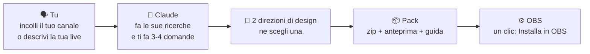
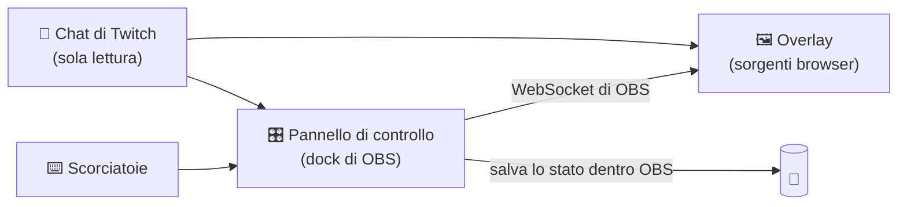

<div align="center">


# OverlayGenerator

**Una skill di Claude che progetta un pack completo di overlay per OBS a partire dal *tuo* canale, non un template con sopra il tuo nome.**

[English](../../README.md) · [Español](README.es.md) · [Português (BR)](README.pt-BR.md) · [Français](README.fr.md) · [Deutsch](README.de.md) · **Italiano** · [日本語](README.ja.md) · [한국어](README.ko.md) · [简体中文](README.zh-CN.md)


[Cosa ricevi](#-cosa-ricevi) · [Esempi](#-niente-template) · [Avvisi](#-gli-avvisi-in-azione) · [Pannello](#️-il-pannello-di-controllo) · [Installa](#-installa-la-skill) · [Configura OBS](#️-configura-obs-passo-dopo-passo) · [FAQ](#-faq-e-problemi) · [Traduci](#-traduzioni)

</div>

> [!IMPORTANT]
> **Pre-release.** L'architettura è stata testata in OBS 32 su Windows: pannello di controllo, installazione in OBS con un clic, scorciatoie da tastiera, comandi in chat e memoria. La skill vera e propria è in costruzione. Clicca **Watch → Custom → Releases** per sapere quando esce la v1. I passaggi qui sotto descrivono come funzionerà la v1.

> [!NOTE]
> Questa è una traduzione del [README in inglese](../../README.md) e potrebbe essere un po' indietro.

---

## ✨ Cosa fa

Racconti a Claude com'è la tua live, oppure incolli semplicemente il tuo canale Twitch. Claude guarda a cosa giochi, come parli con la chat e cosa rende il tuo canale *tuo*, e su questo progetta un pack di overlay completo:

```text
Tu:     Fammi un pack di overlay. Il mio canale è twitch.tv/il_tuo_canale
Claude: Ho guardato le tue ultime live: soprattutto Elden Ring, run senza
        subire colpi, chat in italiano, conti le morti a mano nel
        titolo... Ecco due direzioni. Quale ti somiglia di più?
```

Scegli una direzione, Claude costruisce il pack e ricevi uno zip pronto per OBS. Senza programmare e senza template da compilare.

## 🎁 Cosa ricevi

| Cosa | Dettagli |
|---|---|
| 🎬 **Scene** | Si comincia, Torno subito, Fine, più le tue scene principali (gioco, chiacchiere, programmazione, telegiornale…) |
| 🔔 **Avvisi** | Sub, resub, sub regalato, pioggia di sub, raid e bits, scritti nella lingua e con l'umorismo del tuo canale |
| 💬 **Chat e obiettivi** | Chat a schermo, obiettivo di sub e cornice della webcam in tinta con il resto del pack |
| 🧩 **Elementi fatti per il tuo formato** | Contatore di morti, boss, scaletta degli argomenti, ticker delle notizie, contatore di giorni… quello che serve davvero alla tua live |
| 🎛️ **Pannello di controllo in OBS** | Pulsanti, **scorciatoie da tastiera** e **comandi in chat per i tuoi mod** per gestire ogni elemento in diretta |
| ⚙️ **Pulsante "Installa in OBS"** | Crea scene e sorgenti al posto tuo, già posizionate |
| 👀 **Anteprima** | Doppio clic su `preview.html` per vedere tutto il pack prima di toccare OBS |
| 📖 **Guida** | Una guida passo passo, semplice e nella tua lingua |

## 🎨 Niente template

Ogni pack nasce dall'**idea del tuo canale**, non da un menu di stili. Questi sono concept realizzati durante lo sviluppo del metodo. Lo stesso evento, un nuovo sub, è completamente diverso su cinque canali:


| # | Idea del canale | L'avviso di sub diventa… |
|---|---|---|
| 1 | Una subathon che non finisce mai, piena di codici sponsor → **un minimarket aperto 24 ore** | Uno scontrino: "1 × abbonamento · subathon +10:00 · Grazie per l'acquisto!" |
| 2 | Un conduttore con i suoi quiz → **un game show televisivo d'altri tempi** | "Abbiamo un sub!" con lampadine, coriandoli e premio |
| 3 | Live di chiacchiere che seguono una lista di argomenti → **una linea della metro** | "Nuovo abbonato · sale sulla Linea 21"; ogni argomento è una fermata |
| 4 | Gioca a un soulslike camminando sul tapis roulant → **un pellegrinaggio** | "Un nuovo pellegrino cammina con te" in una macchia di catrame |
| 5 | Run senza subire colpi, dove conta un solo numero → **lo zero** | Una sottile fascia di vittoria che dice anche quanto tempo aggiunge alla subathon |

<details>
<summary><b>🖼️ Guarda le scene complete</b></summary>
<br>

| | |
|---|---|
|  **Minimarket**: insegna al neon "APERTO" con il timer della subathon, avvisi a scontrino e cartellini del prezzo per gli sponsor |  **Game show**: tabellone del duo, obiettivo di sub come "montepremi" e sottopancia da studio |
|  **Linea della metro**: gli argomenti del giorno come fermate, display LED "prossima fermata" e biglietto obliterato come obiettivo |  **Pellegrinaggio**: ogni morte accelera il tapis roulant, passi del giorno e sigilli del pellegrino come obiettivo di sub |
|  **Senza colpi**: lo 0 è il protagonista, con tentativo, record e boss; sta lontano dall'HUD del gioco |  **…quando vieni colpito**: lo 0 diventa un 1 rosso, il falò si spegne e gli avvisi aspettano la fine del boss |

<sub>Concept non ufficiali basati su informazioni pubbliche dei canali, realizzati solo per sviluppare e testare il metodo. Nessun legame né sostegno da parte di questi creator. "marta_dev" è una spettatrice inventata.</sub>

</details>

### 🔔 Gli avvisi in azione

Ogni pack anima i suoi avvisi a modo suo. Stesso spettatore, stesso sub, sei atmosfere:

<table><tr><td width="50%" align="center"><br><b>Minimarket</b>: stampato come uno scontrino</td><td width="50%" align="center"><br><b>Game show</b>: lampadine, coriandoli e premio</td></tr><tr><td width="50%" align="center"><br><b>Linea della metro</b>: entra come un cartello di banchina</td><td width="50%" align="center"><br><b>Pellegrinaggio</b>: il catrame filtra dalla pietra</td></tr><tr><td width="50%" align="center"><br><b>Senza colpi</b>: una fascia sottile che non disturba il combattimento</td><td width="50%" align="center"><br><b>…e il colpo</b>: lo zero diventa rosso e il falò si spegne</td></tr></table>

<sub>Sono gli stessi concept non ufficiali di sopra. Nel tuo pack ogni avviso è progettato per il tuo canale.</sub>

### Le regole di design di ogni pack

- 🎯 **Fatto per il tuo canale.** Ogni elemento supera un test semplice: "avrebbe senso su un altro canale?". Se sì, viene riprogettato.
- 🕹️ **Rispetta il gioco.** Gli elementi stanno lontani dall'HUD del gioco (vita, minimappa, punteggio) e occupano poco schermo.
- 🔠 **Leggibile dal telefono.** Testo grande e buon contrasto, controllati automaticamente in ogni scena.
- 🧘 **Calmo di default.** Niente va in loop; si muovono solo gli eventi.
- ©️ **Niente di ufficiale.** Può *richiamare* il tuo gioco, ma non usa mai loghi, personaggi, artwork o font ufficiali.
- 🌍 **Nella tua lingua.** La lingua del pack viene rilevata dal tuo canale, e gli avvisi parlano come la tua chat.

## 🎛️ Il pannello di controllo

Ogni pack ha il suo pannello, agganciato dentro OBS. Claude ci mette solo quello che usa la tua live: i pulsanti, le scorciatoie e i comandi in chat dei *tuoi* elementi.

<p align="center"></p>
<p align="center"><sub>Premi <b>F9</b> in gioco, o un mod scrive <code>!hit</code>: lo zero diventa rosso e la caduta viene segnata. Poi nuovo tentativo e due boss sconfitti.</sub></p>

<table><tr><td width="33%" valign="top"><br><b>Diretta</b>: Cambia scena e gestisci ogni elemento. Ogni pulsante mostra la sua scorciatoia e il comando in chat.</td><td width="33%" valign="top"><br><b>Avvisi</b>: Prova ogni avviso, attivali o disattivali e trattienili durante i boss.</td><td width="33%" valign="top"><br><b>Chat</b>: I comandi e chi può usarli. Quelli di chi non è mod vengono ignorati e annotati.</td></tr></table>

<details>
<summary><b>Altro: scorciatoie e impostazioni</b></summary>
<br>

<table><tr><td width="50%" valign="top"><br><b>Scorciatoie</b>: Ogni tasto, la voce di OBS che usa e quando è stato premuto l'ultima volta.</td><td width="50%" valign="top"><br><b>Impostazioni</b>: Connessione, installazione o riparazione con un clic, backup e come aggiornare il pack.</td></tr></table>

</details>

<sub>Il pannello della v1 in modalità demo, con un canale inventato. Schede, pulsanti e comandi cambiano con ogni pack.</sub>

---

## 🧠 Come funziona



Dentro OBS il pack usa **il WebSocket integrato di OBS**. Non serve installare altro: niente Python, niente server, niente account.



---

## 📋 Requisiti

- **OBS Studio 28 o successivo** (testato su Windows; macOS e Linux in programma)
- **Un account Claude** con *Code execution and file creation* attivo (disponibile nei piani Free, Pro, Max, Team ed Enterprise)
- **Un canale Twitch** per avvisi e chat (YouTube e Kick in programma)

## 📥 Installa la skill

> [!NOTE]
> Il download sarà disponibile nelle [Releases](https://github.com/Ro0oman/OverlayGenerator-Claude-Skill/releases) quando uscirà la v1.

### Nell'app di Claude (web o desktop)

1. Scarica `overlay-generator.zip` dall'ultima versione. **Non estrarlo.**
2. In Claude apri **Settings → Capabilities** e attiva **Code execution and file creation**.
3. Vai su **Customize → Skills**, clicca **+** e poi **+ Create skill → Upload a skill**.
4. Scegli lo zip e controlla che la skill sia **attiva**.

Nei piani Team ed Enterprise potrebbe servire che un amministratore abiliti prima le skill. Vedi [Use skills in Claude](https://support.claude.com/en/articles/12512180-use-skills-in-claude).

> I nomi dei menu sono in inglese; la tua app potrebbe mostrarli in italiano.

### In Claude Code

Le skill attive nel tuo account Claude compaiono da sole in Claude Code (controlla con `/skills`). Per installarla in locale, estraila in `~/.claude/skills/`:

```bash
unzip overlay-generator.zip -d ~/.claude/skills/
```

## 🚀 Crea il tuo pack

Apri una nuova chat e scrivi qualcosa come:

> *Fammi un pack di overlay per OBS. Il mio canale è twitch.tv/il_tuo_canale*

oppure, senza canale:

> *Faccio live di Minecraft hardcore in italiano, atmosfera rilassata. Voglio un contatore di giorni e un obiettivo di 10 sub.*

Claude:

1. **Ti chiederà 1–2 screenshot della tua live.** È facoltativo, ma fa una grande differenza: mostra dove sono la tua webcam e l'HUD del gioco.
2. Riassumerà quello che ha trovato e ti farà qualche domanda breve (webcam o VTuber, obiettivo di sub, sponsor, argomenti da evitare).
3. Ti mostrerà **due direzioni di design** con anteprima. Ne scegli una o chiedi modifiche.
4. Ti darà **lo zip del pack**.

---

## 🛠️ Configura OBS passo dopo passo

Ci vogliono circa 5 minuti e si fa una volta sola.

> I nomi dei menu di OBS sono in inglese; il tuo OBS potrebbe mostrarli in italiano.

### 1. Estrai il pack in una cartella fissa

Per esempio in `C:\Overlays\il-mio-pack`.

> [!WARNING]
> **Non** in Download, **non** dentro lo zip e **non** in una cartella sincronizzata con OneDrive o Dropbox. OBS continua a puntare a quella cartella: se la sposti, gli overlay smettono di funzionare.

### 2. Attiva il WebSocket di OBS

1. In OBS apri **Tools → WebSocket Server Settings**.
2. Spunta **Enable WebSocket server**.
3. Lascia attivo **Enable Authentication** e clicca **Show Connect Info** per copiare la **password**.
4. Clicca **OK**.

### 3. Aggiungi il pannello di controllo come dock

1. Apri **Docks → Custom Browser Docks…**
2. Dagli un nome, per esempio `Pannello overlay`.
3. In URL incolla l'indirizzo di `panel.html` nella tua cartella, per esempio `file:///C:/Overlays/il-mio-pack/panel.html`.
4. Clicca **Apply**. Il pannello compare dentro OBS e puoi trascinarlo dove vuoi.

### 4. Connetti e installa

Incolla la password del WebSocket nel pannello, clicca **Connetti** e poi **⚙ Installa in OBS**.

Il pannello crea tutte le scene e le sorgenti al posto tuo, già posizionate. Puoi ricliccare senza problemi: ripara o aggiorna senza duplicare nulla.

<p align="center"></p>
<p align="center"><sub>Prototipo del pannello in OBS 32 subito dopo "Installa in OBS". L'aspetto del pannello finale può cambiare.</sub></p>

### 5. Facoltativo: scorciatoie per non uscire mai dal gioco

Alcuni elementi (contatore di morti, "prossimo boss", "prossimo argomento"…) hanno delle scorciatoie.

1. Apri **Settings → Hotkeys**.
2. Cerca le voci **OVG ·** del pack.
3. Assegna un tasto a **Show 'OVG · …'** (per esempio F9 per +1). Lascia vuoto **Hide**.
4. Clicca **OK**. Il tasto funziona da qualsiasi scena, anche mentre giochi.

<table><tr>
<td width="55%"></td>
<td><br><sub>Assegna un tasto a <b>Show</b>, premilo in gioco e l'overlay si aggiorna.</sub></td>
</tr></table>

> [!TIP]
> Le scorciatoie funzionano anche con uno **Stream Deck**, tramite la sua azione per le scorciatoie di OBS.

### 6. Facoltativo: comandi in chat per i tuoi mod

Scrivi il nome del tuo canale nel pannello e clicca **Ascolta la chat**. Da lì in poi i tuoi mod (e tu) potete usare i comandi del pack, come `!morte` o `!avanti`. Quelli del resto della chat vengono ignorati.

### 7. In onda

> [!CAUTION]
> **Tieni il pannello aperto durante la live.** È il cervello del pack. Puoi ridurre il dock a icona, ma non chiuderlo. Se si chiude, gli overlay tengono l'ultimo stato e mostrano un piccolo avviso **"Pannello chiuso"**, così anche i tuoi spettatori possono avvisarti.

---

## 🔄 Aggiorna o modifica il tuo pack

Manda a Claude lo zip del tuo pack (o solo il suo `pack.json`) e digli cosa vuoi: *"aggiornalo"*, *"aggiungi un tracker dei boss"*, *"rendi gli avvisi più vistosi"*.

1. Claude ricostruisce il pack con **gli stessi nomi dei file**.
2. Estrailo **sopra** la cartella vecchia.
3. Se ci sono elementi nuovi, clicca di nuovo **Installa in OBS**.

I tuoi contatori e le tue impostazioni restano.

## ❓ FAQ e problemi

<details>
<summary><b>L'overlay è vuoto o non reagisce</b></summary>

- Controlla che il pannello dica **Connesso a OBS**.
- Se hai aggiunto una sorgente a mano: nelle proprietà della sorgente browser **togli la spunta a "Local file"** e incolla l'indirizzo completo `file:///…`. Con "Local file" spuntato si perdono le impostazioni contenute nell'indirizzo.
- Clic destro sulla sorgente → **Refresh**.
</details>

<details>
<summary><b>In live compare "Pannello chiuso"</b></summary>

Il dock del pannello di controllo è stato chiuso. Riaprilo dal menu **Docks** e l'avviso sparisce in pochi secondi.
</details>

<details>
<summary><b>Una scorciatoia non funziona dentro un gioco</b></summary>

Alcuni giochi a **schermo intero esclusivo**, o con anti-cheat severi, si tengono i tasti. Metti il gioco in **finestra senza bordi**. Se non basta, usa il comando in chat o uno Stream Deck.
</details>

<details>
<summary><b>Ho svuotato la cache del browser di OBS. Ho perso i contatori?</b></summary>

No. Il pannello tiene una copia del suo stato nel tuo profilo di OBS e la ripristina da solo. È stato testato svuotando la cache e riavviando OBS.
</details>

<details>
<summary><b>È sicuro che la password del WebSocket sia negli indirizzi degli overlay?</b></summary>

Agli overlay serve per parlare con OBS, quindi fa parte del loro indirizzo. Dà accesso solo dal tuo computer o dalla tua rete locale. Se pensi che sia trapelata, generane una nuova in **Tools → WebSocket Server Settings**, inseriscila nel pannello e clicca di nuovo **Installa in OBS**: tutti gli indirizzi vengono riscritti.
</details>

<details>
<summary><b>Supporta follow, donazioni o punti canale?</b></summary>

Da solo, non ancora. Il pack legge la chat di Twitch in modo anonimo, e questo copre sub, resub, sub regalati, piogge di sub, raid e bits. Follow, donazioni e punti canale richiedono l'accesso, quindi la guida spiega come tenere solo quegli avvisi su StreamElements o Streamlabs, con uno stile coordinato.
</details>

<details>
<summary><b>Posso usarlo su YouTube o Kick?</b></summary>

Scene, pannello ed elementi funzionano ovunque funzioni OBS. Avvisi e chat sono solo per Twitch nella v1; YouTube e Kick sono in programma.
</details>

## 🔒 Privacy

- Niente account, niente server, nessun tracciamento. Tutto gira nel **tuo OBS**, sul **tuo computer**.
- La chat di Twitch viene letta **in modo anonimo**, come la vede chi non ha fatto l'accesso.
- I messaggi della chat vengono sempre mostrati come testo, mai come codice.

## 🗺️ Roadmap

- [x] Architettura testata in OBS 32: pannello via WebSocket, installazione con un clic, scorciatoie, comandi per i mod, memoria che resiste allo svuotamento della cache e ai riavvii
- [x] Metodo di design testato su canali reali, con controlli automatici di sovrapposizione con l'HUD, spazio a schermo, dimensione del testo e contrasto
- [ ] **v1**: la skill, il motore, il generatore di pack e il validatore
- [ ] YouTube e Kick
- [ ] Avvisi per follow, donazioni e punti canale
- [ ] Test su macOS e Linux

## 🌍 Traduzioni

Questo README esiste in più lingue. Le versioni non in inglese sono tradotte dall'inglese e possono essere un po' indietro. Se trovi un errore o vuoi aggiungere la tua lingua, guarda **[come tradurre](../TRANSLATING.md)**. Basta una pull request.

I pack di overlay, invece, vengono generati in **qualsiasi lingua** usi il tuo canale.

## 🤝 Contribuire

Issue e idee sono benvenute, soprattutto:

- screenshot del layout della tua live (aiutano a creare la mappa HUD predefinita di ogni gioco),
- formati di live che gli elementi non coprono ancora,
- correzioni alle traduzioni.

---

<div align="center">
<sub>Creato da <a href="https://github.com/Ro0oman">Ro0oman</a> con Claude. Nessun legame con OBS Project, Twitch o Anthropic.</sub>
</div>
