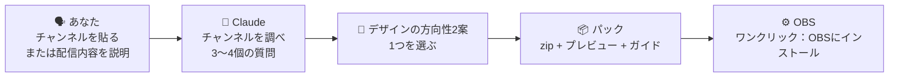
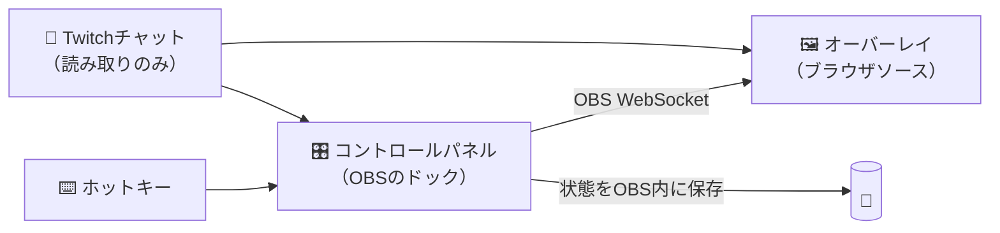

<div align="center">


# OverlayGenerator

**あなたのチャンネルに合わせて、OBS用オーバーレイ一式をまるごとデザインするClaudeスキル。名前を差し替えただけのテンプレートではありません。**

[English](../../README.md) · [Español](README.es.md) · [Português (BR)](README.pt-BR.md) · [Français](README.fr.md) · [Deutsch](README.de.md) · [Italiano](README.it.md) · **日本語** · [한국어](README.ko.md) · [简体中文](README.zh-CN.md)


[手に入るもの](#-手に入るもの) · [作例](#-テンプレートではありません) · [アラート](#-動くアラート) · [パネル](#️-コントロールパネル) · [インストール](#-スキルをインストールする) · [OBSの設定](#️-obsの設定手順) · [FAQ](#-faqとトラブルシューティング) · [翻訳](#-翻訳)

</div>

> [!IMPORTANT]
> **v1 ベータ版です。** スキル本体、エンジン、完全な作例パックを公開しています。すべてシミュレートしたOBSでテスト済みで、中核部分（パネル、ワンクリックインストール、ホットキー、チャットコマンド、状態の保存）は実際のWindows版OBS 32でも確認しています。不具合は[Issue](https://github.com/Ro0oman/OverlayGenerator-Claude-Skill/issues)へどうぞ。

> [!NOTE]
> これは[英語版README](../../README.md)の翻訳です。内容が少し古い場合があります。

---

## ✨ できること

配信の内容をClaudeに伝えるか、Twitchチャンネルを貼り付けるだけです。Claudeはあなたが何をプレイしているか、チャットとどう話しているか、何がそのチャンネル*らしさ*なのかを調べ、それをもとにオーバーレイ一式をデザインします。

```text
あなた: オーバーレイを作って。チャンネルは twitch.tv/your_channel
Claude: 最近の配信を見ました。ほぼエルデンリング、ノーダメージ縛り、
        日本語のチャット、死亡回数をタイトルに手書きで数えていますね…
        方向性を2つ用意しました。どちらがあなたらしいですか？
```

方向性を選ぶとClaudeがパックを組み立て、OBSですぐ使えるzipが届きます。プログラミングも、テンプレートの穴埋めも不要です。

## 🎁 手に入るもの

| 内容 | 詳細 |
|---|---|
| 🎬 **シーン** | 開始前、休憩中、エンディング、そしてメインのシーン（ゲーム、雑談、プログラミング、ニュース番組風…） |
| 🔔 **アラート** | サブスク、継続サブスク、ギフト、ギフトの大量投下、レイド、ビッツ。どれもチャンネルの言語とノリで書かれます |
| 💬 **チャットと目標** | 画面上のチャット、サブスク目標、カメラ枠。すべてパック全体と統一されたデザイン |
| 🧩 **あなたの配信スタイル専用のパーツ** | 死亡カウンター、ボス進捗、トークテーマの予定、ニュースティッカー、日数カウンター…配信に本当に必要なもの |
| 🎛️ **OBS内のコントロールパネル** | ボタン、**ホットキー**、**モデレーター用チャットコマンド**で、配信中に各パーツを操作 |
| ⚙️ **「OBSにインストール」ボタン** | シーンとソースを配置済みの状態で自動作成 |
| 👀 **プレビュー** | `preview.html` をダブルクリックすれば、OBSを触る前にパック全体を確認できます |
| 📖 **ガイド** | あなたの言語で書かれた、わかりやすい手順書 |

## 🎨 テンプレートではありません

どのパックも、スタイルのメニューからではなく**チャンネルの核になるアイデア**から生まれます。以下は手法の開発中に作ったコンセプトです。「新しいサブスク」という同じイベントが、5つのチャンネルでまったく違う姿になります。


| # | チャンネルのアイデア | サブスクアラートはこうなる |
|---|---|---|
| 1 | スポンサーコードだらけの終わらない延長配信 → **24時間営業の街の商店** | レシートが印刷される：「サブスク ×1 ・延長 +10:00 ・お買い上げありがとうございます！」 |
| 2 | 自作のクイズ企画を仕切る司会者 → **昔ながらのテレビのクイズ番組** | 電飾、紙吹雪、賞品つきの「サブスクいただきました！」 |
| 3 | テーマのリストに沿って進む雑談配信 → **地下鉄の路線** | 「新しい定期券 ・21号線に乗車」。テーマが一つずつ駅になる |
| 4 | ランニングマシンで歩きながらソウルライクを遊ぶ → **巡礼の旅** | タールの染みに浮かぶ「新たな巡礼者があなたと共に歩む」 |
| 5 | 被弾ゼロ縛り。大事な数字は一つだけ → **ゼロ** | 延長配信に何分加算されたかも伝える、細い勝利のバナー |

<details>
<summary><b>🖼️ シーン全体を見る</b></summary>
<br>

| | |
|---|---|
|  **街の商店**：延長タイマー付きのネオン「営業中」、レシート型アラート、スポンサーの値札 |  **クイズ番組**：二人組のスコアボード、「賞金」になぞらえたサブスク目標、スタジオ風テロップ |
|  **地下鉄の路線**：今日のテーマを駅に、LEDの「次は」表示、改札で穴を開けた切符が目標 |  **巡礼の旅**：死ぬたびにランニングマシンが加速、今日の歩数、巡礼者の印章がサブスク目標 |
|  **被弾ゼロ**：主役は「0」。挑戦回数、記録、ボス進捗を表示し、ゲームのHUDには重ならない |  **…被弾すると**：0が赤い1に変わり、篝火が消え、アラートはボス戦が終わるまで待機 |

<sub>チャンネルの公開情報をもとにした非公式のコンセプトで、手法の開発とテストのためだけに作成したものです。各クリエイターとは無関係で、承認も受けていません。「marta_dev」は架空の視聴者です。</sub>

</details>

### 🔔 動くアラート

アラートの動きもパックごとに違います。同じ視聴者、同じサブスクでも、雰囲気は6通り：

<table><tr><td width="50%" align="center"><br><b>街の商店</b>: レシートのように印刷される</td><td width="50%" align="center"><br><b>クイズ番組</b>: 電飾、紙吹雪、賞品</td></tr><tr><td width="50%" align="center"><br><b>地下鉄の路線</b>: 駅の案内表示のように入ってくる</td><td width="50%" align="center"><br><b>巡礼の旅</b>: タールが石に染み出す</td></tr><tr><td width="50%" align="center"><br><b>被弾ゼロ</b>: 戦闘の邪魔をしない細いバナー</td><td width="50%" align="center"><br><b>…そして被弾</b>: ゼロが赤くなり、篝火が消える</td></tr></table>

<sub>上と同じ非公式のコンセプトです。実際のパックでは、アラートもあなたのチャンネルに合わせてデザインします。</sub>

### すべてのパックが守るデザインルール

- 🎯 **あなたのチャンネル専用。** 各パーツは「別のチャンネルでも通用するか？」という簡単なテストにかけ、通用してしまうならデザインし直します。
- 🕹️ **ゲームを邪魔しない。** ゲームのHUD（体力、ミニマップ、スコア）を避け、画面の占有を小さく抑えます。
- 🔠 **スマホでも読める。** 大きな文字と十分なコントラストを、全シーンで自動チェックします。
- 🧘 **基本は静か。** 永遠にループするアニメーションはなし。動くのはイベントのときだけです。
- ©️ **公式素材は使わない。** ゲームを*連想させる*ことはあっても、ロゴ、キャラクター、アートワーク、公式フォントは一切使いません。
- 🌍 **あなたの言語で。** パックの言語はチャンネルから判定し、アラートもあなたのチャットらしい言葉で書きます。

## 🎛️ コントロールパネル

どのパックにも、OBSにドッキングする専用パネルが付いています。Claudeが入れるのは、あなたの配信で使うものだけ。*あなたの*パーツのボタン、ホットキー、チャットコマンドです。

<p align="center"></p>
<p align="center"><sub>ゲーム中に <b>F9</b> を押すか、モデレーターが <code>!turb</code> と打つとタービュランスが増えます。<b>Final approach</b> でボス戦中のアラートを保留、<b>Undo</b> で押し間違いを戻せます。</sub></p>

<table><tr><td width="33%" valign="top"><br><b>ライブ</b>: シーンの切り替えと各パーツの操作。ボタンごとにホットキーとチャットコマンドを表示。</td><td width="33%" valign="top"><br><b>アラート</b>: アラートごとのテスト、オン・オフ、ボス戦中の保留。</td><td width="33%" valign="top"><br><b>チャット</b>: コマンドと使える人。モデレーター以外のコマンドは無視して記録します。</td></tr></table>

<details>
<summary><b>その他：ホットキーと設定</b></summary>
<br>

<table><tr><td width="50%" valign="top"><br><b>ホットキー</b>: 各キー、使っているOBSの項目、最後に押された時刻。</td><td width="50%" valign="top"><br><b>設定</b>: 接続、ワンクリックのインストール・修復、バックアップ、パックの更新方法。</td></tr></table>

</details>

<sub>v1パネルを架空のチャンネルでデモ表示したものです。カード、ボタン、コマンドはパックごとに変わります。</sub>

---

## 🧠 仕組み



OBSの中では、**OBSに内蔵されたWebSocket**を使います。Python、サーバー、アカウントなど、追加でインストールするものはありません。



---

## 📋 必要なもの

- **OBS Studio 28以降**（Windowsで確認済み。macOSとLinuxは予定）
- **Claudeのアカウント**。*Code execution and file creation* を有効にしておく（Free、Pro、Max、Team、Enterpriseで利用可）
- アラートとチャット用の**Twitchチャンネル**（YouTubeとKickは予定）

## 📥 スキルをインストールする

> [!NOTE]
> [最新リリース](https://github.com/Ro0oman/OverlayGenerator-Claude-Skill/releases/latest)から `overlay-generator.zip` をダウンロードしてください。

### Claudeアプリ（Web・デスクトップ）

1. 最新リリースから `overlay-generator.zip` をダウンロードします。**解凍はしないでください。**
2. Claudeで **Settings → Capabilities** を開き、**Code execution and file creation** を有効にします。
3. **Customize → Skills** で **+** をクリックし、**+ Create skill → Upload a skill** を選びます。
4. zipを選び、スキルが**オン**になっていることを確認します。

TeamやEnterpriseのプランでは、先に管理者がスキルを許可する必要がある場合があります。詳しくは[Use skills in Claude](https://support.claude.com/en/articles/12512180-use-skills-in-claude)を参照してください。

> メニュー名は英語で記載しています。アプリでは日本語で表示される場合があります。

### Claude Code

Claudeアカウントで有効にしたスキルは、Claude Codeに自動で同期されます（`/skills` で確認できます）。ローカルにインストールする場合は、`~/.claude/skills/` に解凍します。

```bash
unzip overlay-generator.zip -d ~/.claude/skills/
```

または、このリポジトリから直接プラグインとしてインストールできます。

```text
/plugin install overlay-generator --marketplace Ro0oman/OverlayGenerator-Claude-Skill
```

## 🚀 パックを作る

新しいチャットを開き、たとえばこう伝えます。

> *OBS用のオーバーレイを一式作って。チャンネルは twitch.tv/your_channel*

チャンネルなしでも大丈夫です。

> *日本語でマイクラのハードコアを配信してる。まったり系。日数カウンターとサブスク10人の目標がほしい。*

Claudeは次の流れで進めます。

1. **配信のスクリーンショットを1〜2枚お願いします。** 任意ですが、カメラとゲームのHUDの位置がわかるので、仕上がりが大きく変わります。
2. 調べた内容をまとめ、いくつか短い質問をします（カメラかVTuberか、サブスク目標、スポンサー、避けたい話題）。
3. プレビュー付きで**デザインの方向性を2案**見せます。どちらかを選ぶか、修正を頼めます。
4. **パックのzip**を渡します。

---

## 🛠️ OBSの設定手順

5分ほどで終わり、一度やれば完了です。

> OBSのメニュー名は英語で記載しています。お使いのOBSでは日本語で表示される場合があります。

### 1. パックを決まったフォルダに解凍する

たとえば `C:\Overlays\my-pack` に解凍します。

> [!WARNING]
> ダウンロードフォルダ、zipの中、OneDriveやDropboxの同期フォルダは**避けてください**。OBSはこのフォルダを参照し続けるため、場所が変わるとオーバーレイが動かなくなります。

### 2. OBSのWebSocketを有効にする

1. OBSで **Tools → WebSocket Server Settings** を開きます。
2. **Enable WebSocket server** にチェックを入れます。
3. **Enable Authentication** はチェックしたままにし、**Show Connect Info** を押して**パスワード**をコピーします。
4. **OK** を押します。

### 3. コントロールパネルをドックとして追加する

1. **Docks → Custom Browser Docks…** を開きます。
2. 名前を付けます。例：`オーバーレイパネル`
3. URL欄に、フォルダ内の `panel.html` のアドレスを貼ります。例：`file:///C:/Overlays/my-pack/panel.html`
4. **Apply** を押します。パネルがOBS内に表示され、好きな場所にドラッグできます。

### 4. 接続してインストールする

パネルにWebSocketのパスワードを貼り、**接続**を押してから **⚙ OBSにインストール** を押します。

すべてのシーンとソースが配置済みの状態で作成されます。もう一度押しても大丈夫です。重複させずに修復・更新します。

<p align="center"></p>
<p align="center"><sub>「OBSにインストール」直後の、OBS 32上の試作パネル。完成版の見た目は変わる可能性があります。</sub></p>

### 5. 任意：ホットキーでゲームから離れずに操作

一部のパーツ（死亡カウンター、「次のボス」、「次のテーマ」など）にはホットキーが用意されています。

1. **Settings → Hotkeys** を開きます。
2. パックの **OVG ·** で始まる項目を探します。
3. **Show 'OVG · …'** にキーを割り当てます（例：+1にF9）。**Hide** は空のままにします。
4. **OK** を押します。どのシーンでも、ゲーム中でもキーが効きます。

<table><tr>
<td width="55%"></td>
<td><br><sub><b>Show</b> にキーを割り当て、ゲーム中に押すとオーバーレイが更新されます。</sub></td>
</tr></table>

> [!TIP]
> ホットキーは **Stream Deck** のOBSホットキー機能からも使えます。

### 6. 任意：モデレーター用のチャットコマンド

パネルにチャンネル名を入力し、**チャットを受信** を押します。以後、モデレーター（とあなた）はパックのコマンド（例：`!death`、`!next`）を使えます。それ以外の人のコマンドは無視されます。

### 7. 配信開始

> [!CAUTION]
> **配信中はパネルを開いたままにしてください。** パネルはパックの頭脳です。最小化はできますが、閉じないでください。閉じた場合、オーバーレイは最後の状態を保ったまま、小さく **「パネルが閉じています」** と表示します。視聴者が気づいて教えてくれることもあります。

---

## 🔄 パックの更新・変更

パックのzip（または `pack.json` だけ）をClaudeに渡し、やりたいことを伝えます。例：*「アップデートして」*、*「ボス進捗を追加して」*、*「アラートをもっと派手に」*

1. Claudeが**同じファイル名のまま**パックを作り直します。
2. 古いフォルダの**上に上書きで**解凍します。
3. 新しいパーツがあれば、もう一度 **OBSにインストール** を押します。

カウンターや設定はそのまま残ります。

## ❓ FAQとトラブルシューティング

<details>
<summary><b>オーバーレイが真っ白、または反応しない</b></summary>

- パネルに **OBSに接続済み** と表示されているか確認してください。
- ソースを手動で追加した場合は、ブラウザソースのプロパティで **「Local file」のチェックを外し**、`file:///…` の完全なアドレスを貼ってください。「Local file」がオンだと、アドレスに含まれる設定が失われます。
- ソースを右クリック → **Refresh**。
</details>

<details>
<summary><b>配信画面に「パネルが閉じています」と出る</b></summary>

コントロールパネルのドックが閉じられています。**Docks** メニューから開き直すと、数秒で表示が消えます。
</details>

<details>
<summary><b>特定のゲームの中でホットキーが効かない</b></summary>

**排他的フルスクリーン**のゲームや、厳しいアンチチートのあるゲームでは、キー入力が奪われることがあります。ゲームを**ボーダーレスウィンドウ**にしてください。それでもだめなら、チャットコマンドかStream Deckを使ってください。
</details>

<details>
<summary><b>OBSのブラウザキャッシュを消した。カウンターは消えた？</b></summary>

消えません。パネルは状態のコピーをOBSのプロファイル内に保存し、自動で復元します。キャッシュ削除とOBSの再起動で確認済みです。
</details>

<details>
<summary><b>オーバーレイのアドレスにWebSocketのパスワードが入っていて大丈夫？</b></summary>

オーバーレイがOBSと通信するために必要なので、アドレスに含まれています。アクセスできるのは自分のPCかローカルネットワークからだけです。漏れたと思ったら、**Tools → WebSocket Server Settings** で新しいパスワードを作り、パネルに入れてもう一度 **OBSにインストール** を押してください。すべてのアドレスが書き換わります。
</details>

<details>
<summary><b>フォロー、投げ銭、チャンネルポイントには対応している？</b></summary>

単体ではまだ対応していません。パックはTwitchチャットを匿名で読み取り、サブスク、継続サブスク、ギフト、ギフトの大量投下、レイド、ビッツをカバーします。フォロー、投げ銭、チャンネルポイントにはログインが必要なため、それらのアラートだけをStreamElementsやStreamlabsに残し、見た目を揃える方法をガイドで説明します。
</details>

<details>
<summary><b>YouTubeやKickでも使える？</b></summary>

シーン、パネル、パーツはOBSが動く環境ならどこでも使えます。v1ではアラートとチャットはTwitch専用です。YouTubeとKickは対応予定です。
</details>

## 🔒 プライバシー

- アカウント、サーバー、トラッキングは一切なし。すべて**あなたのPC**の**あなたのOBS**の中で動きます。
- Twitchチャットは、ログインしていない視聴者と同じように**匿名で**読み取ります。
- チャットのメッセージは常にテキストとして表示し、コードとして扱うことはありません。

## 🗺️ ロードマップ

- [x] OBS 32で仕組みを確認済み：WebSocket経由のパネル、ワンクリックインストール、ホットキー、モデレーター用コマンド、キャッシュ削除や再起動後も残る状態保存
- [x] 実在のチャンネルでデザイン手法を検証。HUDとの重なり、画面占有率、文字サイズ、コントラストを自動チェック
- [x] **v1**：スキル本体、エンジン、パック生成、検証ツール
- [ ] YouTubeとKick
- [ ] フォロー、投げ銭、チャンネルポイントのアラート
- [ ] macOSとLinuxでの動作確認

## 🌍 翻訳

このREADMEは複数の言語で公開しています。英語以外の版は英語版からの翻訳なので、少し遅れることがあります。誤りを見つけたり、自分の言語を追加したい場合は **[翻訳の方法](../TRANSLATING.md)** をご覧ください。プルリクエストを送るだけです。

オーバーレイのパック自体は、チャンネルで使われている**どの言語でも**生成できます。

## 🤝 コントリビュート

Issueやアイデアを歓迎します。特に次のものは助かります。

- 配信レイアウトのスクリーンショット（ゲームごとの標準HUDマップ作りに役立ちます）
- パーツがまだ対応していない配信スタイル
- 翻訳の修正

---

<div align="center">
<sub><a href="https://github.com/Ro0oman">Ro0oman</a> がClaudeと一緒に作りました。OBS Project、Twitch、Anthropicとは関係ありません。</sub>
</div>
