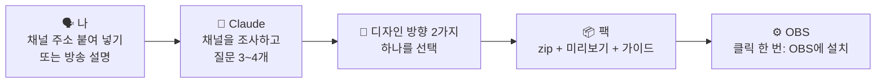
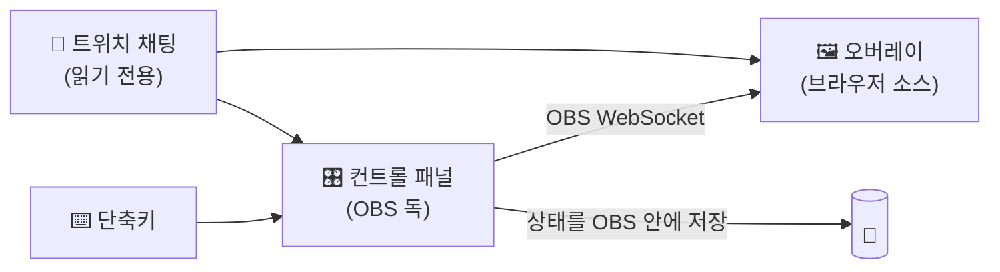

<div align="center">


# OverlayGenerator

**내 채널을 바탕으로 OBS 오버레이 팩 전체를 디자인해 주는 Claude 스킬. 이름만 바꾼 템플릿이 아닙니다.**

[English](../../README.md) · [Español](README.es.md) · [Português (BR)](README.pt-BR.md) · [Français](README.fr.md) · [Deutsch](README.de.md) · [Italiano](README.it.md) · [日本語](README.ja.md) · **한국어** · [简体中文](README.zh-CN.md)


[](https://overlays.romandev.app/ko/) [](https://overlays.romandev.app/demo/)

[받는 것](#-받는-것) · [예시](#-템플릿이-아닙니다) · [알림](#-움직이는-알림) · [패널](#️-컨트롤-패널) · [설치](#-스킬-설치하기) · [OBS 설정](#️-obs-설정-단계별-안내) · [FAQ](#-faq와-문제-해결) · [번역](#-번역)

</div>

> [!IMPORTANT]
> **v1 베타입니다.** 스킬, 엔진, 완성된 예시 팩이 모두 들어 있습니다. 전부 시뮬레이션한 OBS로 테스트했고, 핵심 기능(패널, 클릭 한 번 설치, 단축키, 채팅 명령어, 상태 저장)은 실제 Windows용 OBS 32에서도 확인했습니다. 버그를 찾으셨나요? [이슈를 열어 주세요](https://github.com/Ro0oman/OverlayGenerator-Claude-Skill/issues).

> [!NOTE]
> 이 문서는 [영어 README](../../README.md)의 번역본이며, 내용이 조금 늦게 반영될 수 있습니다.

---

## ✨ 무엇을 하나요

Claude에게 방송 이야기를 하거나, 트위치 채널 주소만 붙여 넣으면 됩니다. Claude가 어떤 게임을 하는지, 채팅과 어떻게 소통하는지, 무엇이 그 채널*다움*을 만드는지 살펴보고, 그걸 바탕으로 오버레이 팩 전체를 디자인합니다.

```text
나:     오버레이 팩 만들어 줘. 내 채널은 twitch.tv/your_channel
Claude: 최근 방송을 봤어요. 주로 엘든 링, 노히트 도전, 한국어 채팅,
        제목에 데스 수를 직접 세고 계시네요...
        방향을 두 가지 준비했어요. 어느 쪽이 더 본인다운가요?
```

방향을 고르면 Claude가 팩을 만들고, OBS에 바로 쓸 수 있는 zip 파일을 받게 됩니다. 코딩도, 템플릿 채우기도 필요 없습니다.

## 🎁 받는 것

| 항목 | 설명 |
|---|---|
| 🎬 **장면** | 방송 시작 전, 잠시 자리 비움, 엔딩, 그리고 메인 장면(게임, 저스트 채팅, 코딩, 뉴스 데스크…) |
| 🔔 **알림** | 구독, 재구독, 선물 구독, 구독 폭탄, 레이드, 비트. 모두 채널의 언어와 유머로 작성됩니다 |
| 💬 **채팅과 목표** | 화면 채팅, 구독 목표, 카메라 프레임이 팩 전체와 어울리게 디자인됩니다 |
| 🧩 **내 방송 형식에 맞춘 요소** | 데스 카운터, 보스 진행도, 토크 주제 목록, 뉴스 티커, 일수 카운터… 방송에 정말 필요한 것들 |
| 🎛️ **OBS 안의 컨트롤 패널** | 버튼, **단축키**, **모더레이터용 채팅 명령어**로 방송 중 각 요소를 조작 |
| ⚙️ **"OBS에 설치" 버튼** | 장면과 소스를 위치까지 잡아서 자동으로 만들어 줍니다 |
| 👀 **미리보기** | `preview.html`을 더블클릭하면 OBS를 건드리기 전에 팩 전체를 볼 수 있습니다 |
| 📖 **가이드** | 내 언어로 된 쉬운 단계별 안내서 |

## 🎨 템플릿이 아닙니다

모든 팩은 스타일 메뉴가 아니라 **채널의 핵심 아이디어**에서 출발합니다. 아래는 방법론을 개발하면서 만든 콘셉트입니다. "새 구독"이라는 같은 이벤트가 다섯 채널에서 완전히 다르게 보입니다.


| # | 채널의 아이디어 | 구독 알림은 이렇게 됩니다 |
|---|---|---|
| 1 | 스폰서 코드가 가득한, 끝나지 않는 연장 방송 → **24시간 동네 구멍가게** | 영수증 출력: "구독 ×1 · 연장 +10:00 · 구매해 주셔서 감사합니다!" |
| 2 | 직접 퀴즈 코너를 진행하는 진행자 → **옛날 TV 퀴즈쇼** | 전구 장식, 꽃가루, 상품이 함께하는 "구독 들어왔습니다!" |
| 3 | 주제 목록을 따라가는 토크 방송 → **지하철 노선** | "새 정기권 · 21호선 탑승"; 주제 하나하나가 역이 됩니다 |
| 4 | 러닝머신 위를 걸으며 소울라이크를 하는 방송 → **순례길** | 타르 얼룩 위의 "새로운 순례자가 함께 걷습니다" |
| 5 | 노히트 도전, 중요한 숫자는 단 하나 → **0** | 연장 방송에 얼마나 더해지는지도 알려 주는 얇은 승리 배너 |

<details>
<summary><b>🖼️ 전체 장면 보기</b></summary>
<br>

| | |
|---|---|
|  **구멍가게**: 연장 타이머가 들어간 네온 "영업 중", 영수증 알림, 스폰서 가격표 |  **퀴즈쇼**: 2인 점수판, "상금"이 된 구독 목표, 스튜디오 자막 |
|  **지하철 노선**: 오늘의 주제가 역으로, LED "다음 역" 표시, 펀칭된 승차권이 목표 |  **순례길**: 죽을 때마다 러닝머신이 빨라지고, 오늘의 걸음 수, 순례자 도장이 구독 목표 |
|  **노히트**: 주인공은 "0". 시도 횟수, 기록, 보스 진행도를 보여 주고 게임 HUD는 가리지 않습니다 |  **…맞았을 때**: 0이 빨간 1로 바뀌고, 화톳불이 꺼지고, 알림은 보스전이 끝날 때까지 대기 |

<sub>채널의 공개 정보를 바탕으로, 방법론 개발과 테스트만을 위해 만든 비공식 콘셉트입니다. 해당 크리에이터와 관련이 없으며 승인받지 않았습니다. "marta_dev"는 가상의 시청자입니다.</sub>

</details>

### 🔔 움직이는 알림

팩마다 알림이 움직이는 방식도 다릅니다. 같은 시청자, 같은 구독, 여섯 가지 분위기:

<table><tr><td width="50%" align="center"><br><b>구멍가게</b>: 영수증처럼 인쇄됩니다</td><td width="50%" align="center"><br><b>퀴즈쇼</b>: 전구, 꽃가루, 상품</td></tr><tr><td width="50%" align="center"><br><b>지하철 노선</b>: 승강장 안내판처럼 들어옵니다</td><td width="50%" align="center"><br><b>순례길</b>: 타르가 돌 사이로 스며듭니다</td></tr><tr><td width="50%" align="center"><br><b>노히트</b>: 전투를 방해하지 않는 얇은 배너</td><td width="50%" align="center"><br><b>…그리고 피격</b>: 0이 빨갛게 변하고 화톳불이 꺼집니다</td></tr></table>

<sub>위와 같은 비공식 콘셉트입니다. 실제 팩에서는 알림도 내 채널에 맞게 디자인됩니다.</sub>

### 모든 팩이 지키는 디자인 규칙

- 🎯 **내 채널 전용.** 각 요소는 "다른 채널에서도 말이 될까?"라는 간단한 테스트를 거칩니다. 말이 된다면 다시 디자인합니다.
- 🕹️ **게임을 존중합니다.** 게임 HUD(체력, 미니맵, 점수판)를 피하고 화면을 조금만 차지합니다.
- 🔠 **휴대폰에서도 읽힙니다.** 큰 글자와 충분한 대비를 모든 장면에서 자동으로 검사합니다.
- 🧘 **기본은 차분하게.** 끝없이 반복되는 애니메이션은 없습니다. 움직이는 건 이벤트뿐입니다.
- ©️ **공식 자료는 쓰지 않습니다.** 게임을 *연상시킬* 수는 있지만 로고, 캐릭터, 아트워크, 공식 글꼴은 절대 쓰지 않습니다.
- 🌍 **내 언어로.** 팩의 언어는 채널에서 감지하고, 알림 문구도 내 채팅처럼 씁니다.

## 🎛️ 컨트롤 패널

모든 팩에는 OBS 안에 도킹되는 전용 패널이 있습니다. Claude는 내 방송에서 쓰는 것만 넣습니다. *내* 요소들의 버튼, 단축키, 채팅 명령어요.

<p align="center"></p>
<p align="center"><sub>게임 중에 <b>F9</b>를 누르거나 모더레이터가 <code>!turb</code>를 입력하면 난기류가 올라갑니다. <b>Final approach</b>는 보스전 동안 알림을 대기시키고, <b>Undo</b>는 실수를 되돌립니다.</sub></p>

<table><tr><td width="33%" valign="top"><br><b>라이브</b>: 장면을 바꾸고 각 요소를 조작합니다. 버튼마다 단축키와 채팅 명령어가 표시됩니다.</td><td width="33%" valign="top"><br><b>알림</b>: 알림별 테스트, 켜기·끄기, 보스전 동안 대기.</td><td width="33%" valign="top"><br><b>채팅</b>: 명령어와 사용할 수 있는 사람. 모더레이터가 아닌 사람의 명령어는 무시하고 기록합니다.</td></tr></table>

<details>
<summary><b>더 보기: 단축키와 설정</b></summary>
<br>

<table><tr><td width="50%" valign="top"><br><b>단축키</b>: 각 키, 사용하는 OBS 항목, 마지막으로 누른 시각.</td><td width="50%" valign="top"><br><b>설정</b>: 연결, 클릭 한 번 설치·복구, 백업, 팩 업데이트 방법.</td></tr></table>

</details>

<sub>가상의 채널로 데모 모드에서 실행한 v1 패널입니다. 카드, 버튼, 명령어는 팩마다 달라집니다.</sub>

---

## 🧠 작동 방식



OBS 안에서 팩은 **OBS에 내장된 WebSocket**을 사용합니다. Python, 서버, 계정 등 따로 설치할 것은 없습니다.



---

## 📋 준비물

- **OBS Studio 28 이상** (Windows에서 테스트 완료, macOS와 Linux는 예정)
- *Code execution and file creation*을 켠 **Claude 계정** (Free, Pro, Max, Team, Enterprise에서 사용 가능)
- 알림과 채팅에 쓸 **트위치 채널** (YouTube와 Kick은 예정)

## 📥 스킬 설치하기

> [!NOTE]
> [최신 릴리스](https://github.com/Ro0oman/OverlayGenerator-Claude-Skill/releases/latest)에서 `overlay-generator.zip`을 내려받으세요.

### Claude 앱(웹, 데스크톱)

1. 최신 릴리스에서 `overlay-generator.zip`을 내려받습니다. **압축은 풀지 마세요.**
2. Claude에서 **Settings → Capabilities**를 열고 **Code execution and file creation**을 켭니다.
3. **Customize → Skills**에서 **+**를 누른 뒤 **+ Create skill → Upload a skill**을 선택합니다.
4. zip 파일을 고르고 스킬이 **켜져** 있는지 확인합니다.

Team과 Enterprise 플랜에서는 관리자가 먼저 스킬을 허용해야 할 수 있습니다. [Use skills in Claude](https://support.claude.com/en/articles/12512180-use-skills-in-claude)를 참고하세요.

> 메뉴 이름은 영어로 적었습니다. 앱에서는 한국어로 표시될 수 있습니다.

### Claude Code

Claude 계정에서 켠 스킬은 Claude Code에 자동으로 동기화됩니다(`/skills`로 확인). 로컬에 설치하려면 `~/.claude/skills/`에 압축을 풉니다.

```bash
unzip overlay-generator.zip -d ~/.claude/skills/
```

또는 이 저장소에서 바로 플러그인으로 설치할 수 있습니다.

```text
/plugin install overlay-generator --marketplace Ro0oman/OverlayGenerator-Claude-Skill
```

## 🚀 팩 만들기

새 채팅을 열고 이렇게 말해 보세요.

> *OBS 오버레이 팩 만들어 줘. 내 채널은 twitch.tv/your_channel*

채널 없이도 됩니다.

> *한국어로 마인크래프트 하드코어 방송해. 잔잔한 분위기. 일수 카운터랑 구독 10명 목표가 필요해.*

Claude는 이렇게 진행합니다.

1. **방송 스크린샷 1~2장을 요청합니다.** 선택 사항이지만 카메라와 게임 HUD 위치를 알 수 있어서 결과가 크게 달라집니다.
2. 찾은 내용을 정리하고 짧은 질문을 몇 가지 합니다(카메라 또는 VTuber, 구독 목표, 스폰서, 피하고 싶은 주제).
3. 미리보기와 함께 **디자인 방향 두 가지**를 보여 줍니다. 하나를 고르거나 수정을 요청하면 됩니다.
4. **팩 zip 파일**을 줍니다.

---

## 🛠️ OBS 설정, 단계별 안내

5분 정도 걸리고, 한 번만 하면 됩니다.

> OBS 메뉴 이름은 영어로 적었습니다. 사용하는 OBS에서는 한국어로 표시될 수 있습니다.

### 1. 팩을 고정된 폴더에 압축 풀기

예를 들어 `C:\Overlays\my-pack`에 풉니다.

> [!WARNING]
> 다운로드 폴더, zip 내부, OneDrive나 Dropbox 동기화 폴더는 **피하세요**. OBS가 이 폴더를 계속 참조하기 때문에, 폴더가 옮겨지면 오버레이가 작동하지 않습니다.

### 2. OBS WebSocket 켜기

1. OBS에서 **Tools → WebSocket Server Settings**를 엽니다.
2. **Enable WebSocket server**를 체크합니다.
3. **Enable Authentication**은 체크한 채로 두고, **Show Connect Info**를 눌러 **비밀번호**를 복사합니다.
4. **OK**를 누릅니다.

### 3. 컨트롤 패널을 독으로 추가하기

1. **Docks → Custom Browser Docks…**를 엽니다.
2. 이름을 정합니다. 예: `오버레이 패널`
3. URL 칸에 폴더 안 `panel.html`의 주소를 붙여 넣습니다. 예: `file:///C:/Overlays/my-pack/panel.html`
4. **Apply**를 누릅니다. 패널이 OBS 안에 나타나고 원하는 곳으로 끌어 옮길 수 있습니다.

### 4. 연결하고 설치하기

패널에 WebSocket 비밀번호를 붙여 넣고 **연결**을 누른 다음 **⚙ OBS에 설치**를 누릅니다.

모든 장면과 소스가 위치까지 잡힌 채로 만들어집니다. 다시 눌러도 괜찮습니다. 중복 없이 복구하거나 업데이트합니다.

<p align="center"></p>
<p align="center"><sub>"OBS에 설치" 직후 OBS 32의 시제품 패널. 최종 패널의 모습은 달라질 수 있습니다.</sub></p>

### 5. 선택: 게임을 떠나지 않도록 단축키 설정

일부 요소(데스 카운터, "다음 보스", "다음 주제" 등)에는 단축키가 있습니다.

1. **Settings → Hotkeys**를 엽니다.
2. 팩의 **OVG ·** 항목을 찾습니다.
3. **Show 'OVG · …'**에 키를 지정합니다(예: +1에 F9). **Hide**는 비워 둡니다.
4. **OK**를 누릅니다. 이제 어떤 장면에서도, 게임 중에도 키가 작동합니다.

<table><tr>
<td width="55%"></td>
<td><br><sub><b>Show</b>에 키를 지정하고 게임 중에 누르면 오버레이가 갱신됩니다.</sub></td>
</tr></table>

> [!TIP]
> 단축키는 **Stream Deck**의 OBS 단축키 기능으로도 쓸 수 있습니다.

### 6. 선택: 모더레이터용 채팅 명령어

패널에 채널 이름을 입력하고 **채팅 듣기**를 누릅니다. 그때부터 모더레이터(와 나)는 팩에 들어 있는 명령어(예: `!death`, `!next`)를 쓸 수 있습니다. 다른 사람의 명령어는 무시됩니다.

### 7. 방송 시작

> [!CAUTION]
> **방송하는 동안 패널을 열어 두세요.** 패널은 팩의 두뇌입니다. 독을 최소화해도 되지만 닫지는 마세요. 닫히면 오버레이는 마지막 상태를 유지하고 작게 **"패널이 닫혔습니다"**라고 표시합니다. 시청자가 보고 알려 줄 수도 있습니다.

---

## 🔄 팩 업데이트하거나 바꾸기

팩 zip(또는 `pack.json`만)을 Claude에게 보내고 원하는 걸 말하세요. 예: *"업데이트해 줘"*, *"보스 진행도 추가해 줘"*, *"알림을 더 화려하게"*

1. Claude가 **같은 파일 이름**으로 팩을 다시 만듭니다.
2. 기존 폴더 **위에 덮어써서** 압축을 풉니다.
3. 새 요소가 있으면 **OBS에 설치**를 다시 누릅니다.

카운터와 설정은 그대로 유지됩니다.

## ❓ FAQ와 문제 해결

<details>
<summary><b>오버레이가 비어 있거나 반응하지 않아요</b></summary>

- 패널에 **OBS에 연결됨**이라고 나오는지 확인하세요.
- 소스를 직접 추가했다면: 브라우저 소스 속성에서 **"Local file" 체크를 해제**하고 `file:///…` 전체 주소를 붙여 넣으세요. "Local file"이 켜져 있으면 주소에 담긴 설정이 사라집니다.
- 소스를 우클릭 → **Refresh**.
</details>

<details>
<summary><b>방송 화면에 "패널이 닫혔습니다"가 떠요</b></summary>

컨트롤 패널 독이 닫혔습니다. **Docks** 메뉴에서 다시 열면 몇 초 안에 사라집니다.
</details>

<details>
<summary><b>어떤 게임 안에서는 단축키가 안 먹혀요</b></summary>

**전용 전체 화면** 게임이나 안티치트가 엄격한 게임은 키 입력을 가져갈 수 있습니다. 게임을 **테두리 없는 창 모드**로 바꾸세요. 그래도 안 되면 채팅 명령어나 Stream Deck을 쓰세요.
</details>

<details>
<summary><b>OBS 브라우저 캐시를 지웠어요. 카운터가 날아갔나요?</b></summary>

아니요. 패널은 상태의 사본을 OBS 프로필 안에 저장해 두고 자동으로 복원합니다. 캐시 삭제와 OBS 재시작으로 테스트했습니다.
</details>

<details>
<summary><b>오버레이 주소에 WebSocket 비밀번호가 들어가도 안전한가요?</b></summary>

오버레이가 OBS와 통신하려면 필요해서 주소에 들어갑니다. 내 컴퓨터나 로컬 네트워크에서만 접근할 수 있습니다. 유출됐다고 생각되면 **Tools → WebSocket Server Settings**에서 새 비밀번호를 만들어 패널에 넣고 **OBS에 설치**를 다시 누르세요. 모든 주소가 새로 작성됩니다.
</details>

<details>
<summary><b>팔로우, 후원, 채널 포인트도 되나요?</b></summary>

아직은 단독으로 지원하지 않습니다. 팩은 트위치 채팅을 익명으로 읽기 때문에 구독, 재구독, 선물 구독, 구독 폭탄, 레이드, 비트를 다룹니다. 팔로우, 후원, 채널 포인트는 로그인이 필요해서, 해당 알림만 StreamElements나 Streamlabs에 남기고 디자인을 맞추는 방법을 가이드에서 안내합니다.
</details>

<details>
<summary><b>YouTube나 Kick에서도 쓸 수 있나요?</b></summary>

장면, 패널, 요소는 OBS가 돌아가는 곳이면 어디서든 작동합니다. v1에서 알림과 채팅은 트위치 전용이며, YouTube와 Kick은 지원 예정입니다.
</details>

## 🔒 개인정보

- 계정도, 서버도, 추적도 없습니다. 모든 것이 **내 컴퓨터**의 **내 OBS** 안에서 돌아갑니다.
- 트위치 채팅은 로그인하지 않은 시청자처럼 **익명으로** 읽습니다.
- 채팅 메시지는 항상 텍스트로만 표시하고, 코드로 처리하지 않습니다.

## 🗺️ 로드맵

- [x] OBS 32에서 구조 테스트 완료: WebSocket 패널, 클릭 한 번 설치, 단축키, 모더레이터 명령어, 캐시 삭제와 재시작 후에도 남는 상태 저장
- [x] 실제 채널로 디자인 방법론 검증. HUD 겹침, 화면 점유, 글자 크기, 대비를 자동 검사
- [x] **v1**: 스킬, 엔진, 팩 빌더, 검증 도구
- [ ] YouTube와 Kick
- [ ] 팔로우, 후원, 채널 포인트 알림
- [ ] macOS와 Linux 테스트

## 🌍 번역

이 README는 여러 언어로 제공됩니다. 영어가 아닌 버전은 영어판을 번역한 것이라 조금 늦을 수 있습니다. 오류를 발견했거나 내 언어를 추가하고 싶다면 **[번역하는 방법](../TRANSLATING.md)**을 보세요. 풀 리퀘스트 하나면 됩니다.

오버레이 팩은 채널에서 쓰는 **어떤 언어로든** 만들어집니다.

## 🤝 기여하기

이슈와 아이디어를 환영합니다. 특히 이런 것들이요.

- 방송 레이아웃 스크린샷(게임별 기본 HUD 지도를 만드는 데 도움이 됩니다)
- 아직 요소가 다루지 못하는 방송 형식
- 번역 수정

---

<div align="center">
<sub><a href="https://github.com/Ro0oman">Ro0oman</a>이 Claude와 함께 만들었습니다. OBS Project, Twitch, Anthropic과는 관련이 없습니다.</sub>
</div>
