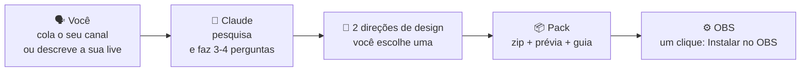
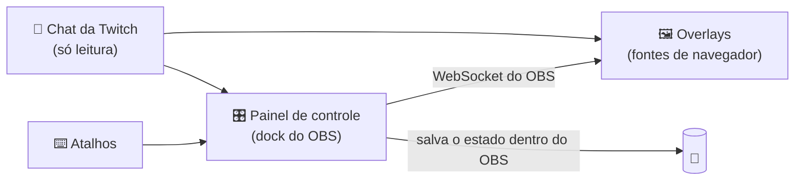

<div align="center">


# OverlayGenerator

**Uma skill do Claude que cria um pack completo de overlays para OBS a partir do *seu* canal, e não um template com o seu nome em cima.**

[English](../../README.md) · [Español](README.es.md) · **Português (BR)** · [Français](README.fr.md) · [Deutsch](README.de.md) · [Italiano](README.it.md) · [日本語](README.ja.md) · [한국어](README.ko.md) · [简体中文](README.zh-CN.md)


[O que você recebe](#-o-que-você-recebe) · [Exemplos](#-nada-de-templates) · [Instalar](#-instalar-a-skill) · [Configurar o OBS](#️-configurar-o-obs-passo-a-passo) · [Dúvidas](#-dúvidas-e-problemas) · [Traduzir](#-traduções)

</div>

> [!IMPORTANT]
> **Pré-lançamento.** A arquitetura já foi testada no OBS 32 no Windows: painel de controle, instalação no OBS com um clique, atalhos de teclado, comandos de chat e memória. A skill em si está sendo construída. Clique em **Watch → Custom → Releases** para saber quando a v1 sair. Os passos abaixo descrevem como a v1 vai funcionar.

> [!NOTE]
> Esta é uma tradução do [README em inglês](../../README.md) e pode estar um pouco desatualizada.

---

## ✨ O que faz

Você conta ao Claude como são as suas lives, ou simplesmente cola o seu canal da Twitch. O Claude vê o que você joga, como você fala com o chat e o que torna o seu canal *seu*, e cria um pack de overlays completo em cima disso:

```text
Você:   Faz um pack de overlays pra mim. Meu canal é twitch.tv/seu_canal
Claude: Olhei suas últimas lives: quase tudo Elden Ring, runs sem levar
        dano, chat em português, você conta as mortes à mão no título...
        Aqui vão duas direções. Qual tem mais a sua cara?
```

Você escolhe uma direção, o Claude monta o pack e você recebe um zip pronto para o OBS. Sem programar e sem preencher templates.

## 🎁 O que você recebe

| | |
|---|---|
| 🎬 **Cenas** | Começando, Já volto, Encerramento, e as suas cenas principais (jogo, bate-papo, programação, telejornal…) |
| 🔔 **Alertas** | Sub, resub, sub de presente, chuva de subs, raid e bits, escritos no idioma e no humor do seu canal |
| 💬 **Chat e metas** | Chat na tela, meta de subs e moldura de câmera combinando com o resto do pack |
| 🧩 **Peças feitas para o seu formato** | Contador de mortes, chefes, pauta de assuntos, letreiros de telejornal, contador de dias… o que a sua live realmente precisa |
| 🎛️ **Painel de controle dentro do OBS** | Botões, **atalhos de teclado** e **comandos de chat para os seus mods** para controlar cada peça ao vivo |
| ⚙️ **Botão "Instalar no OBS"** | Cria as cenas e as fontes para você, já posicionadas |
| 👀 **Prévia** | Clique duas vezes em `preview.html` para ver o pack inteiro antes de mexer no OBS |
| 📖 **Guia** | Um guia passo a passo, simples e no seu idioma |

## 🎨 Nada de templates

Cada pack nasce da **ideia do seu canal**, não de um menu de estilos. Estes são conceitos feitos durante o desenvolvimento do método. O mesmo evento, um sub novo, fica completamente diferente em cinco canais:


| # | Ideia do canal | O alerta de sub vira… |
|---|---|---|
| 1 | Uma subathon que nunca acaba, cheia de códigos de patrocínio → **uma vendinha aberta 24 h** | Um cupom fiscal: "1 × inscrição · subathon +10:00 · Obrigado pela compra!" |
| 2 | Um apresentador com os próprios programas de perguntas → **um game show de TV das antigas** | "Temos sub!" com lâmpadas, confete e prêmio |
| 3 | Lives de bate-papo que seguem uma lista de assuntos → **uma linha de metrô** | "Novo passageiro · embarca na Linha 21"; cada assunto é uma estação |
| 4 | Joga um soulslike andando na esteira → **uma peregrinação** | "Um novo peregrino caminha com você" numa mancha de piche |
| 5 | Runs sem levar dano, onde só um número importa → **o zero** | Uma faixa de vitória fina que também diz quanto tempo soma à subathon |

<details>
<summary><b>🖼️ Ver as cenas completas</b></summary>
<br>

| | |
|---|---|
|  **Vendinha**: neon "ABERTO" com o tempo da subathon, alertas em cupom e etiquetas de preço com os patrocínios |  **Game show**: placar da dupla, meta de subs como "o prêmio acumulado" e letreiro de estúdio |
|  **Linha de metrô**: os assuntos do dia como estações, painel de LED "próxima estação" e bilhete perfurado como meta |  **Peregrinação**: cada morte acelera a esteira, passos do dia e selos do peregrino como meta de subs |
|  **Sem dano**: o 0 é o protagonista, com tentativa, recorde e chefe; não cobre o HUD do jogo |  **…quando você leva dano**: o 0 vira um 1 vermelho, a fogueira apaga e os alertas esperam o chefe acabar |

<sub>Conceitos não oficiais baseados em informações públicas dos canais, feitos só para desenvolver e testar o método. Sem vínculo nem apoio desses criadores. "marta_dev" é uma espectadora inventada.</sub>

</details>

### Regras de design que todo pack segue

- 🎯 **Feito para o seu canal.** Cada peça passa por um teste simples: "isso faria sentido em outro canal?". Se sim, ela é redesenhada.
- 🕹️ **Respeita o jogo.** As peças ficam longe do HUD do jogo (vida, minimapa, placar) e ocupam pouco da tela.
- 🔠 **Legível no celular.** Texto grande e bom contraste, verificados automaticamente em cada cena.
- 🧘 **Calmo por padrão.** Nada fica em loop; só os eventos se movem.
- ©️ **Nada oficial.** Pode *lembrar* o seu jogo, mas nunca usa logos, personagens, artes ou fontes oficiais.
- 🌍 **No seu idioma.** O idioma do pack é detectado no seu canal, e os alertas falam como o seu chat.

---

## 🧠 Como funciona



Dentro do OBS, o pack usa **o próprio WebSocket do OBS**. Não precisa instalar mais nada: nem Python, nem servidor, nem conta.



---

## 📋 Requisitos

- **OBS Studio 28 ou mais recente** (testado no Windows; macOS e Linux estão nos planos)
- **Uma conta do Claude** com *Execução de código e criação de arquivos* ativada (disponível nos planos Free, Pro, Max, Team e Enterprise)
- **Um canal da Twitch** para os alertas e o chat (YouTube e Kick estão nos planos)

## 📥 Instalar a skill

> [!NOTE]
> O download vai estar em [Releases](https://github.com/Ro0oman/OverlayGenerator-Claude-Skill/releases) quando a v1 for publicada.

### No app do Claude (web ou desktop)

1. Baixe o `overlay-generator.zip` da versão mais recente. **Não descompacte.**
2. No Claude, abra **Settings → Capabilities** e ative **Code execution and file creation**.
3. Vá em **Customize → Skills**, clique em **+** e depois em **+ Create skill → Upload a skill**.
4. Escolha o zip e confira se a skill está **ativada**.

Nos planos Team e Enterprise, talvez um administrador precise liberar as skills antes. Veja [Use skills in Claude](https://support.claude.com/en/articles/12512180-use-skills-in-claude).

> Os nomes dos menus estão em inglês; no seu app eles podem aparecer em português.

### No Claude Code

As skills ativadas na sua conta do Claude aparecem sozinhas no Claude Code (confira com `/skills`). Se preferir instalar localmente, descompacte em `~/.claude/skills/`:

```bash
unzip overlay-generator.zip -d ~/.claude/skills/
```

## 🚀 Crie o seu pack

Abra um chat novo e diga algo como:

> *Faz um pack de overlays para OBS pra mim. Meu canal é twitch.tv/seu_canal*

ou, sem canal:

> *Faço lives de Minecraft hardcore em português, clima tranquilo. Quero um contador de dias e uma meta de 10 subs.*

O Claude vai:

1. **Pedir 1–2 prints da sua live.** É opcional, mas faz muita diferença: mostra onde estão a sua câmera e o HUD do jogo.
2. Resumir o que encontrou e fazer algumas perguntas curtas (câmera ou VTuber, meta de subs, patrocinadores, assuntos a evitar).
3. Mostrar **duas direções de design** com prévia. Você escolhe uma ou pede mudanças.
4. Entregar **o zip do pack**.

---

## 🛠️ Configurar o OBS, passo a passo

Leva uns 5 minutos e só precisa ser feito uma vez.

> Os nomes dos menus do OBS estão em inglês; no seu OBS eles podem aparecer em português.

### 1. Descompacte o pack numa pasta fixa

Por exemplo, em `C:\Overlays\meu-pack`.

> [!WARNING]
> **Não** em Downloads, **não** dentro do zip e **não** numa pasta sincronizada com OneDrive ou Dropbox. O OBS continua apontando para essa pasta; se ela mudar de lugar, os overlays param de funcionar.

### 2. Ative o WebSocket do OBS

1. No OBS, abra **Tools → WebSocket Server Settings**.
2. Marque **Enable WebSocket server**.
3. Deixe **Enable Authentication** marcado e clique em **Show Connect Info** para copiar a **senha**.
4. Clique em **OK**.

### 3. Adicione o painel de controle como dock

1. Abra **Docks → Custom Browser Docks…**
2. Dê um nome, por exemplo `Painel overlay`.
3. Em URL, cole o endereço do `panel.html` da sua pasta, por exemplo `file:///C:/Overlays/meu-pack/panel.html`.
4. Clique em **Apply**. O painel aparece dentro do OBS e você pode arrastá-lo para onde quiser.

### 4. Conecte e instale

Cole a senha do WebSocket no painel, clique em **Conectar** e depois em **⚙ Instalar no OBS**.

O painel cria todas as cenas e fontes para você, já posicionadas. Pode clicar de novo sem medo: ele repara ou atualiza sem duplicar nada.

<p align="center"></p>
<p align="center"><sub>Protótipo do painel no OBS 32 logo depois de "Instalar no OBS". A aparência do painel final pode mudar.</sub></p>

### 5. Opcional: atalhos de teclado, para não sair do jogo

Algumas peças (contador de mortes, "próximo chefe", "próximo assunto"…) vêm com atalhos.

1. Abra **Settings → Hotkeys**.
2. Procure as entradas **OVG ·** do pack.
3. Coloque uma tecla em **Show 'OVG · …'** (por exemplo, F9 para +1). Deixe **Hide** vazio.
4. Clique em **OK**. A tecla funciona em qualquer cena, inclusive com o jogo na frente.

<table><tr>
<td width="55%"></td>
<td><br><sub>Coloque uma tecla em <b>Show</b>, aperte no jogo e o overlay atualiza.</sub></td>
</tr></table>

> [!TIP]
> Os atalhos também funcionam com um **Stream Deck**, usando a ação de atalho do OBS.

### 6. Opcional: comandos de chat para os seus mods

Escreva o nome do seu canal no painel e clique em **Ouvir chat**. A partir daí, os seus mods (e você) podem usar os comandos que vêm no pack, como `!morte` ou `!proximo`. Os comandos do resto do chat são ignorados.

### 7. Hora da live

> [!CAUTION]
> **Deixe o painel aberto durante a live.** Ele é o cérebro do pack. Você pode minimizar, mas não feche. Se ele fechar, os overlays mantêm o último estado e mostram um pequeno aviso de **"Painel fechado"**, para que até o seu público possa te avisar.

---

## 🔄 Atualizar ou mudar o seu pack

Mande para o Claude o zip do seu pack (ou só o `pack.json`) e diga o que quer: *"atualiza"*, *"adiciona um contador de chefes"*, *"deixa os alertas mais chamativos"*.

1. O Claude refaz o pack com **os mesmos nomes de arquivo**.
2. Descompacte **por cima** da pasta antiga.
3. Se houver peças novas, clique de novo em **Instalar no OBS**.

Os seus contadores e configurações são mantidos.

## ❓ Dúvidas e problemas

<details>
<summary><b>O overlay fica em branco ou não reage</b></summary>

- Confira se o painel diz **Conectado ao OBS**.
- Se você adicionou uma fonte à mão: nas propriedades da fonte de navegador, **desmarque "Local file"** e cole o endereço completo `file:///…`. Com "Local file" marcado, as configurações que vão no endereço se perdem.
- Clique com o botão direito na fonte → **Refresh**.
</details>

<details>
<summary><b>Aparece "Painel fechado" na live</b></summary>

O dock do painel de controle foi fechado. Abra de novo pelo menu **Docks** e o aviso some em poucos segundos.
</details>

<details>
<summary><b>Um atalho não funciona dentro de um jogo</b></summary>

Alguns jogos em **tela cheia exclusiva**, ou com anti-cheat rígido, seguram as teclas. Coloque o jogo em **janela sem bordas**. Se ainda assim não funcionar, use o comando de chat ou um Stream Deck.
</details>

<details>
<summary><b>Limpei o cache do navegador do OBS. Perdi os contadores?</b></summary>

Não. O painel guarda uma cópia do estado dentro do seu perfil do OBS e recupera sozinho. Isso foi testado limpando o cache e reiniciando o OBS.
</details>

<details>
<summary><b>É seguro a senha do WebSocket ir nos endereços dos overlays?</b></summary>

Os overlays precisam dela para falar com o OBS, então ela vai no endereço. Ela só dá acesso a partir do seu computador ou da sua rede local. Se achar que vazou, gere outra em **Tools → WebSocket Server Settings**, coloque no painel e clique de novo em **Instalar no OBS**: todos os endereços são reescritos.
</details>

<details>
<summary><b>Funciona com follows, doações ou pontos do canal?</b></summary>

Sozinho, ainda não. O pack lê o chat da Twitch de forma anônima, e isso cobre subs, resubs, presentes, chuvas de subs, raids e bits. Follows, doações e pontos do canal exigem login, então o guia explica como deixar só esses alertas no StreamElements ou no Streamlabs, com um estilo combinando.
</details>

<details>
<summary><b>Posso usar no YouTube ou na Kick?</b></summary>

As cenas, o painel e as peças funcionam em qualquer lugar onde o OBS funciona. Alertas e chat são só da Twitch na v1; YouTube e Kick estão nos planos.
</details>

## 🔒 Privacidade

- Sem contas, sem servidores, sem rastreamento. Tudo roda no **seu OBS**, no **seu computador**.
- O chat da Twitch é lido **de forma anônima**, do mesmo jeito que alguém sem login vê.
- As mensagens do chat sempre aparecem como texto, nunca como código.

## 🗺️ Roadmap

- [x] Arquitetura testada no OBS 32: painel via WebSocket, instalação com um clique, atalhos, comandos para mods e memória que sobrevive a limpar o cache e reiniciar
- [x] Método de design testado com canais reais, com verificações automáticas de sobreposição com o HUD, espaço na tela, tamanho de texto e contraste
- [ ] **v1**: a skill, o motor, o gerador de packs e o validador
- [ ] YouTube e Kick
- [ ] Alertas de follows, doações e pontos do canal
- [ ] Testes no macOS e no Linux

## 🌍 Traduções

Este README está em vários idiomas. As versões que não estão em inglês são traduzidas do inglês e podem ficar um pouco para trás. Se encontrar um erro ou quiser adicionar o seu idioma, veja **[como traduzir](../TRANSLATING.md)**. Basta um pull request.

Os packs de overlays são gerados em **qualquer idioma** que o seu canal use.

## 🤝 Contribuir

Issues e ideias são bem-vindas, principalmente:

- prints do layout da sua live (ajudam a montar o mapa de HUD padrão de cada jogo),
- formatos de live que as peças ainda não cobrem,
- correções de tradução.

---

<div align="center">
<sub>Feito por <a href="https://github.com/Ro0oman">Ro0oman</a> com o Claude. Sem vínculo com o OBS Project, a Twitch ou a Anthropic.</sub>
</div>
