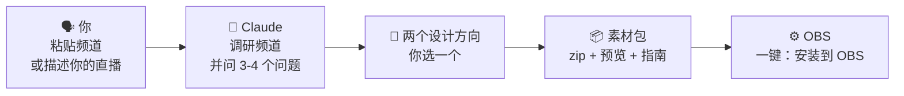
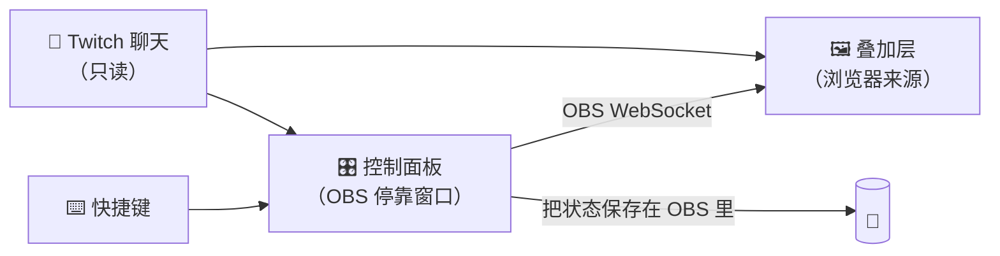

<div align="center">


# OverlayGenerator

**一个 Claude 技能：围绕*你的*频道设计一整套 OBS 叠加层，而不是一个换上你名字的模板。**

[English](../../README.md) · [Español](README.es.md) · [Português (BR)](README.pt-BR.md) · [Français](README.fr.md) · [Deutsch](README.de.md) · [Italiano](README.it.md) · [日本語](README.ja.md) · [한국어](README.ko.md) · **简体中文**


[你会得到什么](#-你会得到什么) · [示例](#-不是模板) · [安装](#-安装技能) · [设置 OBS](#️-一步步设置-obs) · [常见问题](#-常见问题与故障排查) · [翻译](#-翻译)

</div>

> [!IMPORTANT]
> **预发布阶段。** 整体架构（控制面板、一键安装到 OBS、快捷键、聊天命令、状态保存）已在 Windows 版 OBS 32 中测试通过。技能本身正在开发中。点击 **Watch → Custom → Releases** 即可在 v1 发布时收到通知。下面的步骤介绍的是 v1 的使用方式。

> [!NOTE]
> 本文译自[英文 README](../../README.md)，内容可能稍有滞后。

---

## ✨ 它能做什么

把你的直播情况告诉 Claude，或者直接粘贴你的 Twitch 频道。Claude 会看你玩什么游戏、怎么和弹幕互动、是什么让你的频道与众不同，然后据此设计一整套叠加层：

```text
你：     帮我做一套叠加层。我的频道是 twitch.tv/your_channel
Claude： 我看了你最近的直播：主要是《艾尔登法环》，无伤挑战，
         中文弹幕，你在标题里手动记录死亡次数……
         我准备了两个方向，哪个更像你？
```

你选一个方向，Claude 搭好整套素材，你会拿到一个可以直接用于 OBS 的 zip。不用写代码，也不用填模板。

## 🎁 你会得到什么

| 内容 | 说明 |
|---|---|
| 🎬 **场景** | 即将开始、马上回来、下播，以及你的主场景（游戏、闲聊、编程、新闻播报……） |
| 🔔 **提醒** | 订阅、续订、赠送订阅、订阅大礼包、突袭和 Bits，全部用你频道的语言和梗来写 |
| 💬 **聊天与目标** | 屏幕聊天框、订阅目标和摄像头边框，与整套风格统一 |
| 🧩 **为你的直播形式定制的组件** | 死亡计数、Boss 进度、话题议程、新闻滚动条、天数计数……你的直播真正需要的东西 |
| 🎛️ **OBS 内的控制面板** | 按钮、**快捷键**和**房管专用聊天命令**，直播中随时操控每个组件 |
| ⚙️ **"安装到 OBS"按钮** | 自动创建场景和来源，位置都已摆好 |
| 👀 **预览** | 双击 `preview.html`，在动 OBS 之前先看到整套效果 |
| 📖 **指南** | 用你的语言写的简单分步指南 |

## 🎨 不是模板

每套素材都从**你频道的核心创意**出发，而不是从风格菜单里挑。下面是开发这套方法时做的概念稿。同一个事件——一位新订阅者——在五个频道上看起来完全不同：


| # | 频道的创意 | 订阅提醒变成了…… |
|---|---|---|
| 1 | 一场永不结束、满是赞助码的续时直播 → **24 小时营业的街角小卖部** | 打印出来的小票："订阅 ×1 · 续时 +10:00 · 谢谢惠顾！" |
| 2 | 自己主持问答节目的主播 → **复古电视综艺** | 带灯泡、彩带和奖品的"来订阅啦！" |
| 3 | 按话题清单进行的闲聊直播 → **一条地铁线路** | "新乘客 · 登上 21 号线"；每个话题都是一站 |
| 4 | 一边在跑步机上走一边玩类魂游戏 → **一段朝圣之旅** | 焦油污渍里浮现"一位新的朝圣者与你同行" |
| 5 | 无伤挑战，只有一个数字重要 → **零** | 一条细细的胜利横幅，同时显示为续时直播增加了多少时间 |

<details>
<summary><b>🖼️ 查看完整场景</b></summary>
<br>

| | |
|---|---|
|  **小卖部**：带续时计时器的霓虹"营业中"招牌、小票式提醒、赞助商价签 |  **电视综艺**：双人记分牌、"奖池"式订阅目标、演播室字幕条 |
|  **地铁线路**：当天的话题就是站点，LED "下一站"显示屏，打孔车票作为目标 |  **朝圣之旅**：每死一次跑步机就加速，当天步数，朝圣印章作为订阅目标 |
|  **无伤挑战**：主角是"0"，显示尝试次数、纪录和 Boss 进度，并避开游戏 HUD |  **……被打中时**：0 变成红色的 1，篝火熄灭，提醒排队等到 Boss 战结束 |

<sub>基于频道公开信息制作的非官方概念稿，仅用于开发和测试方法。与这些创作者无关，也未获其认可。"marta_dev"是虚构的观众。</sub>

</details>

### 每套素材都遵守的设计规则

- 🎯 **为你的频道而做。** 每个组件都要通过一个简单测试："放到别的频道上也说得通吗？"如果说得通，就重新设计。
- 🕹️ **尊重游戏画面。** 组件避开游戏 HUD（血条、小地图、比分），只占屏幕的一小部分。
- 🔠 **手机上也看得清。** 字号大、对比度高，每个场景都会自动检查。
- 🧘 **默认保持安静。** 没有无限循环的动画，只有事件发生时才会动。
- ©️ **不用官方素材。** 可以*让人联想到*你的游戏，但绝不使用标志、角色、美术或官方字体。
- 🌍 **用你的语言。** 素材的语言会根据你的频道判断，提醒文案读起来就像你的弹幕。

---

## 🧠 工作原理



在 OBS 里，素材包使用 **OBS 自带的 WebSocket**。不需要额外安装任何东西：没有 Python，没有服务器，也不需要账号。



---

## 📋 准备条件

- **OBS Studio 28 或更新版本**（已在 Windows 上测试；macOS 和 Linux 在计划中）
- **一个 Claude 账号**，并开启 *Code execution and file creation*（Free、Pro、Max、Team 和 Enterprise 均可用）
- 用于提醒和聊天的 **Twitch 频道**（YouTube 和 Kick 在计划中）

## 📥 安装技能

> [!NOTE]
> v1 发布后，可在 [Releases](https://github.com/Ro0oman/OverlayGenerator-Claude-Skill/releases) 下载。

### 在 Claude 应用中（网页或桌面版）

1. 从最新版本下载 `overlay-generator.zip`。**不要解压。**
2. 在 Claude 中打开 **Settings → Capabilities**，开启 **Code execution and file creation**。
3. 进入 **Customize → Skills**，点击 **+**，然后选择 **+ Create skill → Upload a skill**。
4. 选择这个 zip，并确认技能已**开启**。

在 Team 和 Enterprise 方案中，可能需要管理员先允许使用技能。详见 [Use skills in Claude](https://support.claude.com/en/articles/12512180-use-skills-in-claude)。

> 菜单名称为英文；你的应用中可能显示为中文。

### 在 Claude Code 中

在 Claude 账号中开启的技能会自动同步到 Claude Code（用 `/skills` 查看）。如果想在本地安装，把它解压到 `~/.claude/skills/`：

```bash
unzip overlay-generator.zip -d ~/.claude/skills/
```

## 🚀 生成你的素材包

新开一个对话，比如这样说：

> *帮我做一套 OBS 叠加层。我的频道是 twitch.tv/your_channel*

没有频道也可以：

> *我用中文直播《我的世界》极限模式，氛围比较轻松。想要一个天数计数器和 10 个订阅的目标。*

Claude 会：

1. **请你提供 1–2 张直播截图。** 这一步可选，但效果差别很大：能看出你的摄像头和游戏 HUD 在哪里。
2. 总结它找到的信息，并问几个简短的问题（真人摄像头还是 VTuber、订阅目标、赞助商、想避开的话题）。
3. 给你看**两个设计方向**和预览。你选一个，或者提出修改。
4. 把**素材包 zip** 交给你。

---

## 🛠️ 一步步设置 OBS

大约 5 分钟，只需设置一次。

> OBS 菜单名称为英文；你的 OBS 中可能显示为中文。

### 1. 把素材包解压到固定的文件夹

例如 `C:\Overlays\my-pack`。

> [!WARNING]
> **不要**放在"下载"文件夹，**不要**直接在 zip 里打开，也**不要**放在 OneDrive 或 Dropbox 同步的文件夹里。OBS 会一直指向这个文件夹，一旦移动，叠加层就会失效。

### 2. 开启 OBS 的 WebSocket

1. 在 OBS 中打开 **Tools → WebSocket Server Settings**。
2. 勾选 **Enable WebSocket server**。
3. 保持 **Enable Authentication** 勾选，点击 **Show Connect Info** 复制**密码**。
4. 点击 **OK**。

### 3. 把控制面板添加为停靠窗口

1. 打开 **Docks → Custom Browser Docks…**
2. 起个名字，例如 `叠加层面板`。
3. 在 URL 中粘贴文件夹里 `panel.html` 的地址，例如 `file:///C:/Overlays/my-pack/panel.html`。
4. 点击 **Apply**。面板会出现在 OBS 里，可以拖到任意位置。

### 4. 连接并安装

把 WebSocket 密码粘贴到面板里，点击**连接**，再点击 **⚙ 安装到 OBS**。

面板会自动创建所有场景和来源，位置都已摆好。可以放心再点一次：它会修复或更新，不会重复创建。

<p align="center"></p>
<p align="center"><sub>OBS 32 中刚点击"安装到 OBS"后的原型面板。正式版面板的外观可能会有变化。</sub></p>

### 5. 可选：用快捷键，不必离开游戏

部分组件（死亡计数、"下一个 Boss"、"下一个话题"等）带有快捷键。

1. 打开 **Settings → Hotkeys**。
2. 找到素材包中以 **OVG ·** 开头的项目。
3. 给 **Show 'OVG · …'** 设置一个按键（例如用 F9 表示 +1）。**Hide** 留空。
4. 点击 **OK**。之后在任何场景、甚至游戏中都能用这个键。

<table><tr>
<td width="55%"></td>
<td><br><sub>给 <b>Show</b> 设置按键，在游戏中按下，叠加层就会更新。</sub></td>
</tr></table>

> [!TIP]
> 快捷键也可以通过 **Stream Deck** 的 OBS 快捷键功能使用。

### 6. 可选：房管专用的聊天命令

在面板中输入你的频道名，点击**监听聊天**。之后你的房管（和你自己）就能使用素材包附带的命令，例如 `!death` 或 `!next`。其他人发的命令会被忽略。

### 7. 开播

> [!CAUTION]
> **直播期间请保持面板打开。** 它是整套素材的大脑。可以最小化，但不要关闭。如果关闭了，叠加层会保持最后的状态，并显示一个小小的 **"面板已关闭"** 提示，这样连观众都能提醒你。

---

## 🔄 更新或修改素材包

把素材包的 zip（或只发 `pack.json`）交给 Claude，说出你的需求：*"更新一下"*、*"加一个 Boss 进度"*、*"让提醒更醒目"*。

1. Claude 会用**相同的文件名**重新生成素材包。
2. 解压并**覆盖**原来的文件夹。
3. 如果有新组件，再点一次**安装到 OBS**。

你的计数和设置都会保留。

## ❓ 常见问题与故障排查

<details>
<summary><b>叠加层一片空白或没有反应</b></summary>

- 确认面板显示**已连接到 OBS**。
- 如果来源是手动添加的：在浏览器来源属性中**取消勾选 "Local file"**，并粘贴完整的 `file:///…` 地址。勾选 "Local file" 会丢失地址里携带的设置。
- 右键点击来源 → **Refresh**。
</details>

<details>
<summary><b>直播画面上出现"面板已关闭"</b></summary>

控制面板的停靠窗口被关掉了。从 **Docks** 菜单重新打开，几秒后提示就会消失。
</details>

<details>
<summary><b>某个游戏里快捷键不起作用</b></summary>

部分**独占全屏**的游戏，或反作弊较严格的游戏，会拦截按键。把游戏改成**无边框窗口**。如果还是不行，就用聊天命令或 Stream Deck。
</details>

<details>
<summary><b>我清除了 OBS 的浏览器缓存，计数还在吗？</b></summary>

还在。面板会在你的 OBS 配置文件中保存一份状态副本，并自动恢复。已经过清除缓存和重启 OBS 的测试。
</details>

<details>
<summary><b>WebSocket 密码出现在叠加层地址里，安全吗？</b></summary>

叠加层需要它和 OBS 通信，所以它是地址的一部分。它只允许从你自己的电脑或局域网访问。如果担心泄露，在 **Tools → WebSocket Server Settings** 里生成新密码，填进面板，再点一次**安装到 OBS**：所有地址都会被重写。
</details>

<details>
<summary><b>支持关注、打赏或频道积分吗？</b></summary>

单靠它自己暂时不支持。素材包以匿名方式读取 Twitch 聊天，可以覆盖订阅、续订、赠送订阅、订阅大礼包、突袭和 Bits。关注、打赏和频道积分需要登录，因此指南会教你如何只把这几类提醒保留在 StreamElements 或 Streamlabs 中，并让风格保持一致。
</details>

<details>
<summary><b>能用在 YouTube 或 Kick 上吗？</b></summary>

场景、面板和组件在任何能运行 OBS 的地方都能用。v1 中提醒和聊天只支持 Twitch；YouTube 和 Kick 在计划中。
</details>

## 🔒 隐私

- 没有账号，没有服务器，没有追踪。一切都在**你的电脑**上的**你的 OBS** 里运行。
- Twitch 聊天以**匿名**方式读取，和未登录的观众看到的一样。
- 聊天消息始终以纯文本显示，绝不会当作代码执行。

## 🗺️ 路线图

- [x] 架构已在 OBS 32 中测试：WebSocket 面板、一键安装、快捷键、房管命令，以及在清除缓存和重启后依然保留的状态
- [x] 设计方法已在真实频道上验证，并自动检查与 HUD 的重叠、屏幕占用、字号和对比度
- [ ] **v1**：技能本体、引擎、素材包生成器和校验工具
- [ ] YouTube 和 Kick
- [ ] 关注、打赏和频道积分提醒
- [ ] macOS 和 Linux 测试

## 🌍 翻译

这份 README 提供多种语言版本。非英文版本译自英文版，可能会稍有滞后。如果你发现错误或想添加自己的语言，请看**[如何翻译](../TRANSLATING.md)**，提交一个 pull request 就行。

叠加层素材包本身可以用你频道使用的**任何语言**生成。

## 🤝 参与贡献

欢迎提交 issue 和想法，尤其是：

- 你的直播布局截图（有助于为每款游戏建立默认的 HUD 地图），
- 组件还没覆盖到的直播形式，
- 翻译修正。

---

<div align="center">
<sub>由 <a href="https://github.com/Ro0oman">Ro0oman</a> 与 Claude 共同制作。与 OBS Project、Twitch 和 Anthropic 无关。</sub>
</div>
